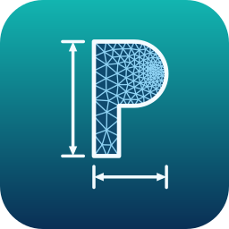

# OpenPara

An open-source parametric CAD modeller written in Python (working title: *Gen Parametric Designer*).

- Parametric parts: sketches with a constraint solver, extrude / cut / revolve / sweep / loft (boss and cut; sweeps can twist), fillet / chamfer, configurations, STEP and STL export of parts and assemblies, and STEP import (File > Import STEP... / Export...; an imported body is the first feature of a new part, and a STEP with several solids can open as one assembly)
- Sketches can use geometry of other sketches (ribbon: Other Sketch): a point, a line, or the point where a sweep path pierces the sketch plane, so a profile can be tied to its path with normal relations and follows it when the path changes
- Assemblies with mates, sub-assemblies and their own Globals (positions, mate values and pattern spacing take formulas)
- One program-wide unit system (File > Units: mm, cm, m, in, ft, N, kN, kip, ... and a separate speed unit)

The core is **Sketch/Part and Assembly** (with STEP / STL exchange, units, settings, materials and AutoSave). Everything else is an **add-on** (File > Add-ons..., or the question that appears when you use one), downloaded from the GitHub release of your version:

- **Part Generator**: spur, helical, herringbone and internal ring gears with true involute teeth; a Gear systems tab sizes a train of up to three gears from centre distances or ratios, or a planetary sun / planet / ring set, and opens each gear as its own part.
- **Truss Generator**: builds the members of a truss from the lines of a sketch (profile, longest length, angled end cuts) and writes a cut list.
- **Simulation**: 1D FEA of frames and trusses (member profiles from basic shapes or from your own sketches of the cross-section), 2D FEA of flat parts (plane stress / strain, linear and nonlinear) and 2D CFD of the flow around a profile, on a sketch or a slice of a part or assembly; results can be saved as animations.
- **Parametric Studies**: varies the inputs of a simulation project over a table of design points and records the outputs (CSV export).

Parts that use the Part Generator keep their data without the add-on and say that they need it. Uninstalling an add-on never touches your files or your material library. Installing needs an internet connection; once installed an add-on works offline. The renderer (Visualize) is not part of this version yet; it is being reworked and will follow as an add-on.

Built on [build123d](https://github.com/gumyr/build123d) (OpenCascade), PyQt6, pyvista / VTK.

## Install (Windows)

1. Go to the [Releases](https://github.com/Bubbletoppoet47/OpenPara/releases) page and download `OpenPara-Setup-<version>.exe`.
2. Run it. It installs OpenPara for your user (no administrator rights), with its own Python and all packages inside, and adds a Start-menu entry.
3. Start **OpenPara** from the Start menu.

OpenPara looks for updates at start-up (Help > Check for updates...) and installs them for you. Your own data (error log, material library, settings)
is kept in `%LOCALAPPDATA%\OpenPara` (Help > Open the data folder) and is never touched by an update.

## Run from source

Windows: double-click `run_modeller.bat` (installs the packages the first time), or

    pip install -r requirements.txt
    python gpd_app.py

## Guides

- `docs/README_modeller.txt` - how the modeller works

## Tests

Each `test_*.py` runs on its own, for example `QT_QPA_PLATFORM=offscreen python test_links.py`.

## Status

Early and in active development. Not everything is tested on every machine. The simulation tools are 1D and 2D: they are for understanding a design early, and do not replace a full 3D analysis, a design-code check or a test.

## License

GNU General Public License v3.0 - see `LICENSE`.

## For the maintainer: making a release

1. Raise `__version__` in `version.py` (and `RUNTIME` only when the Python or the packages change).
2. Commit, then tag: `git tag v<version> && git push origin v<version>`.
3. The workflow `.github/workflows/release.yml` builds the Windows folder on GitHub, makes `OpenPara-Setup-<version>.exe` and
   `OpenPara-app-<version>.zip` (the small update zip) and publishes them as a release.

## The Playground (development builds)

OpenPara Playground is the same program built from the `dev` branch. It installs next to OpenPara (own name, own data folder) and
follows the newest `dev-<version>` pre-release instead of the newest release.

- Work on `dev`. Every push to `dev` runs `.github/workflows/playground.yml`, which builds `OpenPara-Playground-Setup-<version>.exe` and
  `OpenPara-Playground-app-<version>.zip` and publishes them as the pre-release `dev-<version>` (version = `version.py` + the run number,
  e.g. `0.8.6.37`). The newest 10 are kept.
- Install the Playground once from that setup file. After that it offers new builds at start-up (Help > Check for updates), the same way a
  normal OpenPara offers releases.
- A Playground build has two modes (Help > Playground mode; it asks to restart):
  - **Testing** (the default): exactly what the next release would be. Only the add-ons that ship are available, so the menus match
    OpenPara. Those are the add-ons in `addons_src/` except the ids in `addons.NOT_RELEASED` (now Visualize, `render`; Motor Control,
    `motor`; Remote Computer, `remote`; and the Gimble connection, `gimble_link`): they are built for the Playground and offered there in
    Full dev mode only, and a release carries neither their files nor their menus. Taking an id out of that list releases the add-on.
  - **Full dev**: no restrictions. It also loads `dev_addons/` (unreleased add-ons: 3D FEA of parametric parts (`solid_fea`), voxel/mesh FEA, mesh, circuits ...; Simulation and Parametric Studies were released in 0.8.6 and live in `addons_src/`) and `shared/` (code they
    share).
  A release never contains `dev_addons/` or `shared/`.
- Putting an add-on "in testing" means moving it from `dev_addons/<id>/` to `addons_src/<id>/` with an `id`, `version` and `requires` (its pip
  packages) in its `addon.json`, a line in `addons.CATALOG`, and the id in the release workflow's smoke test. From then on it is in Testing mode
  and in the next release.
- On its first start a Playground offers to copy the settings and material library from OpenPara and to install the add-ons OpenPara offers.
- To release: raise `version.py` on `dev`, merge `dev` into `main`, and run the Release workflow as above (it builds the add-ons with
  `tools/build_addons.py dist --release`). Users on the normal program never see `dev-` pre-releases.
- What makes a build a Playground build is `channel.json` next to `channel.py` (written by the workflow); `OPARA_CHANNEL=playground` does the
  same for a source checkout.

## Remote Computer and the Gimble connection (Playground, Full dev mode)

**Remote Computer** (`addons_src/remote/`, File > New Remote Computer) shows the screen of another computer on your network, uses its
keyboard and mouse, copies files to and from it and runs commands there: a Raspberry Pi, or a laptop whose screen is broken.

- The other computer runs one file, `openpara_remote_helper.py` (Python 3.8+, standard library only). "Get the helper..." in the tab saves
  it with a read-me to a folder or USB drive. On that computer: `python3 openpara_remote_helper.py --install` shows an **access code** once
  and makes the helper start with every login; `--check` says what works there (screen, keyboard and mouse); `--new-code`, `--uninstall`,
  `--ask`, `--no-input`, `--no-files`, `--no-commands`, `--no-screen` do what they say.
- Both computers must be on the same network (home Wi-Fi, or a hotspot both joined). "Search this network" finds helpers; "Add by address"
  works where a network blocks searching. Ports: TCP 47800, UDP 47801. The helper says its addresses when it starts and with `--check`;
  the first one is the one to type.
- On Linux the helper listens on every network port by itself, so an answer leaves through the port the question came in by. This matters
  for the Gimble's Pi: its wired port has 192.168.1.2 for the LiDAR, and on a Wi-Fi that also uses 192.168.1.x a single listener answered
  through the wired port, so nothing could connect (helper 1.0; fixed in 1.1, `test_remote_link.py` rebuilds that network).
- When the helper on the other computer is older than OpenPara's, the tab offers "Update its helper": the new file is sent over, started
  there, and the tab connects again. Helper 1.0 cannot do this yet, so it has to be replaced by hand once.
- Whoever has the access code has full control of that account, so it is for computers of your own on a network you trust; never forward
  the port to the internet. Both sides prove the code with SPAKE2 (a wrong guess or a listener gets nothing to test codes against), the
  rest is encrypted and checked, five wrong codes lock an address out for five minutes, and every connection is logged on the other
  computer. It is built from standard parts but has had no security review.
- What is tested: the whole path on Linux with an X11 desktop (`test_remote_link.py`, `test_remote_tab.py`). On Windows the Playground
  build runs `--check` and that test on its build machine and prints the result (for information): there the screen is read and a key is
  sent, and the connection, files and wrong-code handling pass, but nobody has yet watched a Windows desktop being used through it. The
  Wayland back end (`grim` + `/dev/uinput`, for Raspberry Pi OS) is written but has not run on a real machine. A Mac can only be reached
  for files and commands.

**Gimble connection** (`addons_src/gimble_link/`, the Annotator's File menu: Gimble: Send a Model / Download Recordings / Status) works
through that helper on the Gimble rig's Raspberry Pi, so the thumb drive stays in the Pi. It finds the Gimble folder (the one with
`gimble_pi.py` and `gimble_detect.py`), converts a model of the Annotator's Models folder (Assist or Scratch) to `gimble_model.onnx` +
`gimble_model.json` in a job of its own (`gimble_export_job.py`; the converted model is compared with the original before it is sent)
and puts it in `model/`; the model that was there moves to `model/previous/` and can be put back. A Classes + boxes model has no
distance, so the Pi shows no distance of its own for it (the LiDAR distance still shows). A Classes + boxes + distance model (the
Trainer's type below: a detector and a separate distance model) is joined into that one file by the conversion, so the Gimble runs it
like any other model and its programs do not have to be updated for it; the distance model there looks only at the boxes with a
confidence of 0.1 or more, which keeps a picture about as quick as with the detector alone. With a picture open in the Annotator the
converted model is also checked on that picture. A `.pt` dropped on the Send page is added to its list; a `.pt` copied to the Gimble
by hand cannot run there, and the Gimble says so. Recordings are copied from `dataset/` and test videos from
`test_videos/` (files already on the PC are skipped). It needs the Annotator's packages (torch, ultralytics) and downloads onnx and
onnxruntime.

**Trainer: two kinds of model, both from random weights** (`addons_src/trainer/`). "Classes + boxes" trains a stock YOLO model
(`train_helper_job.py`, saved in `Models/Assist`). "Classes + boxes + distance" (`train_distance_job.py`, saved in `Models/Scratch`)
trains two models one after the other: that same detector, then a separate small distance model (`annotator/app/distance_model.py`)
that is told a box and its class and answers metres. The distance model learns from the LiDAR distances picked on boxes in the
Annotator, which travel in the dataset zip and into the run's frozen copy (`distances.csv`). The log scores each model by itself
(the detector's mAP; the distance error on the labelled boxes) and then both together (the distance error from the detector's own
boxes). The result is one file: the detector's `.pt` with the distance model added. Nothing pretrained is offered. "Continue from
existing model" goes on from a model you trained; a Classes + boxes model can get a distance model on top, and "Keep the detector as
it is" trains only the distance model. The earlier one-network distance models (`gimble_model.py`) still work in the Annotator and on
the Gimble but cannot be trained further.
Pressing Start training prepares the run in the background (the distorted copies of the training pictures, then the run's own copy of
the data): the window shows a bar, how far it is, the time left, and Cancel; the copies are made once and kept, also after a cancel.

- Models are listed from every Annotator Models folder on the PC: OpenPara's and the Playground's (they keep separate data folders), in
  `Assist/`, `Scratch/` and directly in `Models/`; "Choose a file..." takes any `.pt`.
- **The Gimble's own programs live in `addons_src/gimble_link/pi/`** (that is their source): `app/` (start screen `gimble_menu.py`,
  Record data `gimble_pi.py`, Test model `gimble_detect.py` with REC VIDEO, calibration, viewer; `gimble_paths.py` is the one place that
  says where things are on the drive), the three launchers and the read-me. "Update the Gimble's programs" on the Status page sends them
  to the Gimble and moves the files of the old layout to `old/before_tidy/`; settings, the model and everything recorded are never
  written. Raise `pi/app/VERSION` with every change. `test_gimble_programs.py` runs them with a stand-in camera, LiDAR and model.

## For contributors
See [docs/DESIGN_PRINCIPLES.md](docs/DESIGN_PRINCIPLES.md) for the design conventions (side panels, results, animations, tables, sketching). Read it before changing how something looks.
