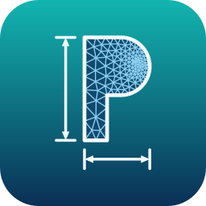

# OpenPara

An open-source parametric CAD modeller written in Python (working title: *Gen Parametric Designer*).

- Parametric parts: sketches with a constraint solver, extrude / cut / revolve / sweep / loft (boss and cut; sweeps can twist), fillet / chamfer, configurations
- Assemblies with mates, sub-assemblies and their own Globals (positions, mate values and pattern spacing take formulas)
- One program-wide unit system (File > Units: mm, cm, m, in, ft, N, kN, kip, ... and a separate speed unit)
- Built-in simulations: 1D beam / frame FEA, 2D FEA, 2D CFD (results and slicing)
- Photorealistic renderer ("Renderer" tab): sun and sky from date / time / place, spot light, floor, several cameras, still pictures and MP4 videos (Mitsuba 3)

Built on [build123d](https://github.com/gumyr/build123d) (OpenCascade), PyQt6, pyvista / VTK, gmsh and Mitsuba 3.

## Install (Windows)

1. Go to the [Releases](https://github.com/Bubbletoppoet47/OpenPara/releases) page and download `OpenPara-Setup-<version>.exe`.
2. Run it. It installs OpenPara for your user (no administrator rights), with its own Python and all packages inside, and adds a Start-menu entry.
3. Start **OpenPara** from the Start menu.

OpenPara looks for updates at start-up (Help > Check for updates...) and installs them for you. Your own data (error log, material library, settings)
is kept in `%LOCALAPPDATA%\OpenPara` (Help > Open the data folder) and is never touched by an update.

## Run from source

Windows: double-click `run_modeller.bat` (installs the packages the first time), or

    pip install -r requirements.txt
    python gpd_app.py

The render studio can also run on its own: `run_render_studio.bat`.

## Guides

- `docs/README_modeller.txt` - how the modeller works
- `docs/README_render.txt` - the render studio

## Tests

Each `test_*.py` runs on its own, for example `QT_QPA_PLATFORM=offscreen python test_links.py`.

## Status

Early and in active development. Not everything is tested on every machine (for example CUDA rendering and the OptiX denoiser).

## License

GNU General Public License v3.0 - see `LICENSE`.

## For the maintainer: making a release

1. Raise `__version__` in `version.py` (and `RUNTIME` only when the Python or the packages change).
2. Commit, then tag: `git tag v<version> && git push origin v<version>`.
3. The workflow `.github/workflows/release.yml` builds the Windows folder on GitHub, makes `OpenPara-Setup-<version>.exe` and
   `OpenPara-app-<version>.zip` (the small update zip) and publishes them as a release.
