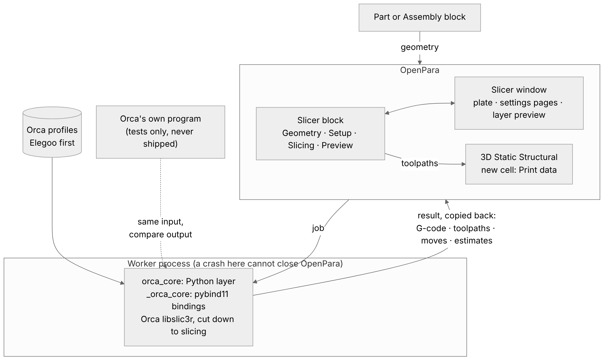
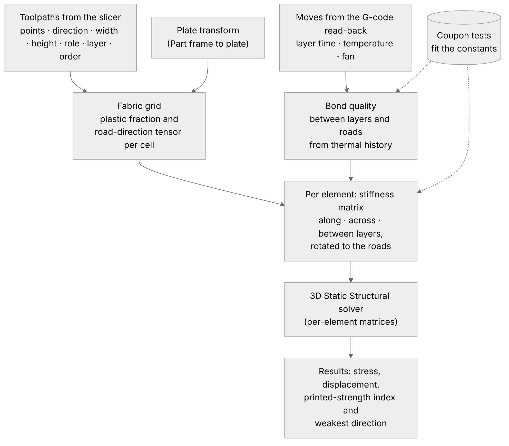
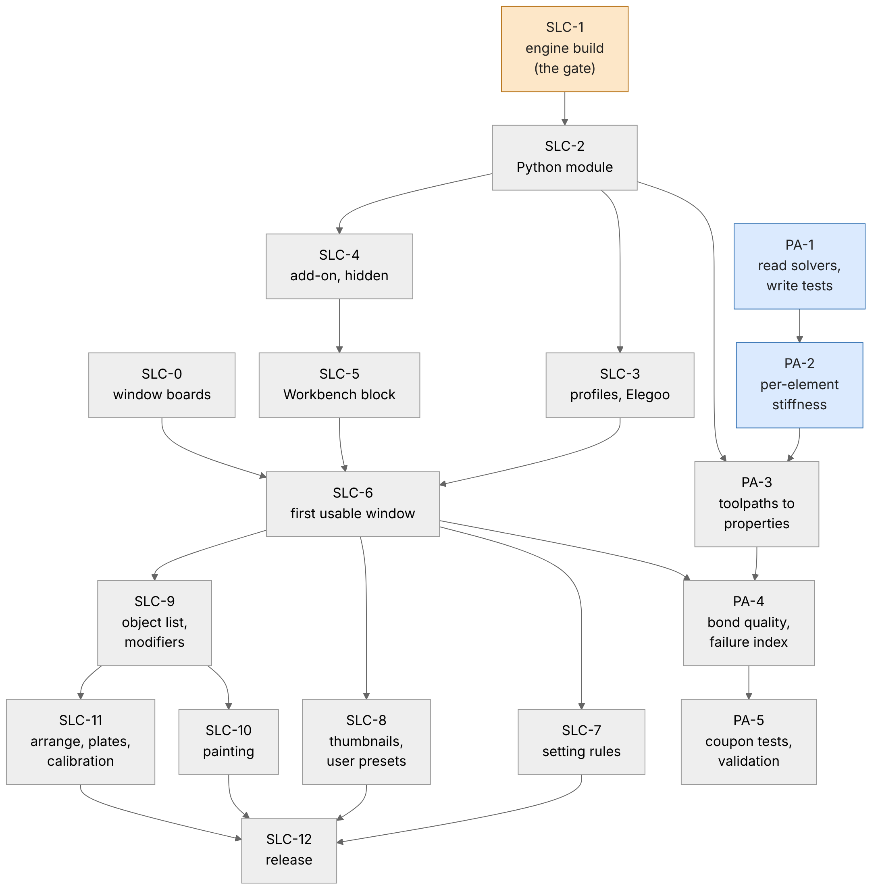

# Slicer in OpenPara: integration plan

**Stage 1 of 2: the plan.** Nothing in OpenPara's program was changed to write it. Stage 2, building it, starts when this plan is finished: Ian asked for that on 2026-11-28, before he had read it, so the decisions in chapter 14.1 run on the defaults given there until he changes them.

| | |
|---|---|
| Status | **Draft 1**, written on 2026-11-27 and 28 (Phoenix time) for Ian Selga. **Not reviewed by him yet:** he asked for Stage 2 to start once this was done, so the defaults in chapter 14.1 are in force until he changes them. |
| Asked for | Ian, 2026-11-27: a slicer inside OpenPara with *the exact same functionality and the same workflow* as Orca Slicer, as a node in the Workbench, whose G-code feeds a 3D analysis of the printed part. Elegoo Centauri Carbon first, any printer in general, with the Elegoo filament presets. |
| Orca read | Orca Slicer source at commit `1044ef4407d7` (version `2.6.0-dev`, 2026-11-28). Latest stable release tag at the time: `v2.5.2`. |
| Where it lives | `planning/design/slicer/` in the repo. `PLAN.md` is the source, this PDF is made from it by `build_pdf.py`. Change `PLAN.md`, then rebuild. |

**How to read this.** Chapter 1 is the whole plan on two pages. Chapters 2 to 4 say what we want and what we found. Chapters 5 to 11 are the design, in the order you would build it. Chapter 12 is the work list, 13 the risks, 14 what I need from you. The appendices hold the raw facts (numbers, file lists, the Centauri Carbon presets, the trial build log).

**How sure each statement is.** Where it matters I say how I know: *(measured)* means I ran it in this session; *(read in code)* means I read it in Orca's or OpenPara's source and give the file; *(my judgment)* means it is my estimate or opinion and should be questioned; *(not checked)* means I did not verify it. Nothing here has been built or tried on Windows.

---

# 1. The plan on two pages

## 1.1 What we are building

A **Slicer block** in the Workbench. A Part, an Assembly or an STL goes in on a wire. Inside the block is a window that works like Orca Slicer: a build plate, an object list, the printer, filament and process settings, a *Slice* button, a layer-by-layer preview, and *Export G-code*. Out of the block come the **G-code**, the **toolpaths as data** (every printed line with its type, width, height and position), and the **print estimates** (time, filament). A 3D Static Structural block can then take the toolpaths and analyse the part *as it would actually be printed*, with different stiffness along and across the printed lines and between layers.



## 1.2 The decisions this plan proposes

| # | Decision | Why, in one line |
|---|---|---|
| D1 | **The engine is Orca's own slicing code (`libslic3r`), compiled and called from Python. It is not rewritten.** | It is the only way to get the same output as Orca. The engine is 345,646 lines of C++; a port would never be provably identical. |
| D2 | The engine is **cut down** to slicing only: no STEP import, no CAD tab, no resin (SLA), no texture baking, no windows. | Those parts are 8 % of the code and carry the heaviest libraries. The first full build (Draft 2) needed three small patches, not one deleted line: `Format/STEP.hpp`, `Model.cpp` and `SLA/Hollowing.cpp` (the OpenVDB half of it). |
| D3 | The engine ships as a **Windows wheel in a new `slicer` add-on**, downloaded on request, hidden from normal releases until finished. | OpenPara already delivers heavy optional parts this way (Trainer's torch, add-ons on the GitHub release). |
| D4 | The **window is rebuilt** in OpenPara's Qt/PyVista style. It is not Orca's wxWidgets window. The settings pages are generated from Orca's own option definitions and page layout, so the names, groups, tips and ranges are Orca's. | Orca's interface is 617,282 lines of wxWidgets/OpenGL, a different toolkit. Its *workflow* and *settings* are what we copy. |
| D5 | **Profiles are Orca's**, loaded by Orca's own preset code, with the Elegoo bundle (18 models, 268 filament presets, all 25 for the Centauri Carbon) shipped unchanged. | Same inheritance and compatibility rules as Orca, for free. |
| D6 | **Anisotropic analysis is its own track** after the slicer works. It starts from the toolpaths the engine already produces. | It changes the structural solver, which is separate work with its own tests and a real-world validation step. |
| D7 | **Parity is tested against Orca itself:** the same model and settings through our module and through Orca's own release program must give the same layers, toolpaths and G-code. Orca's program is a dev and CI test tool only; it is never shipped and never opened by the user. | "Exact same functionality" is only a claim if it is checked. |
| D8 | **Slicing runs in a separate worker process**, not inside OpenPara's own process. | A crash in the C++ engine then cannot close OpenPara, and a cancel can end the worker. |

## 1.3 What the evidence says

- **The size of the job** *(measured)*. `libslic3r` is 345,646 lines in 269 source files. Orca's window code is another 617,282 lines. Orca has about 1,030 settings *(measured by counting definitions)*.
- **The build is feasible** *(measured, partly)*. Nine representative engine files compiled with ordinary Ubuntu libraries (and CGAL 6.2.1 for two) in 9.5 to 76.5 seconds each, using up to 4.2 GB of memory for the heaviest (the CGAL ones). Two core files, `Print.cpp` and `GCode.cpp`, compiled once one line (an include of the STEP header) was deleted; `Model.cpp` needs one function guarded and was not retried. **Not done:** a full build, link and slice. That is the first work item, SLC-1.
- **The Elegoo data exists.** Orca already ships the Centauri Carbon: four nozzle sizes, 21 process presets and 25 filament presets, in the same file format the engine reads *(read in code)*.
- **The data the analysis needs exists in the engine.** Before it writes G-code, Orca holds every printed line as an object with its type (20 kinds), 3D points, width, height and volume per millimetre *(read in code)*.
- **Orca has its own Python layer now**, for plug-ins that run inside the Orca program (pybind11, in `src/slic3r/plugin/`). It exposes layers, toolpaths and meshes to Python, with zero-copy numpy views of the points. It does not run a slice on its own, so it is not our module, but it shows the shape that works and its binding code can be reused (same licence) *(read in code)*.

## 1.4 What is hard

1. **The window**, by a long way. Orca's Plater, object list, settings tabs, preview and painting tools are the "same workflow" you asked for. Chapter 8 lists every part with a priority. The first usable window is a fraction of that, and the rest comes in steps.
2. **The Windows build.** Everything above was measured on Linux. Orca's own continuous build compiles on Windows, so it works there, but we must reproduce it in our GitHub workflow, cache the libraries, and keep it working as Orca changes. Chapter 6.
3. **The analysis is research, not just code.** How closely the printed-part FEA matches reality is unknown until we print and break test pieces. Chapter 10 says how to find out, and does not promise a number.

## 1.5 The first steps

| Step | What | What you can see afterwards |
|---|---|---|
| **SLC-0** | Draw the window as boards (like the Trainer and Visualize boards). | Pictures to approve or change. |
| **SLC-1** | Build the cut-down engine on Linux and Windows in a separate workflow; slice a cube through Python. No change to OpenPara. | A build that passes, and G-code that matches Orca's. |
| **SLC-2** | The Python module with its three levels (one call, stage by stage, single tools). | Toolpaths as arrays you can plot. |
| **SLC-3** | Load Orca's profiles, the Elegoo bundle first. | A list of Elegoo printers and filaments from Python. |
| **SLC-4** | The `slicer` add-on (hidden from normal releases). | Install it in the Playground. |
| **SLC-5** | The Workbench block and wiring. | Wire a Part into a Slicer block. |
| **SLC-6** | The window, first version: plate, settings pages, slice, preview, export. | Slice a Part and save G-code for the Centauri Carbon. |

## 1.6 What I need from you

The decisions in chapter 14, mainly: approve D1 to D8 (or change them), choose the Orca version to build on, and say whether SLC-0 (the boards) comes before the engine build or alongside it.

---

# 2. Goals, non-goals and how we will know it works

## 2.1 What you asked for

From your messages on 2026-11-27, in my words:

1. A **G-code generator inside OpenPara**, based on Orca Slicer because it is more general than the Elegoo one, usable for your Elegoo printers (Centauri Carbon).
2. **Not a second program or window.** Orca's code is taken into OpenPara, the same functions, in OpenPara's own style, used through node inputs and outputs.
3. **The same functionality and the same workflow as Orca**, taken with great care and as close as possible, even if that means going through the C++ code.
4. A way to go from **geometry (part or assembly) to a slicer node to G-code to a 3D simulation node**, so the finite-element analysis of a 3D-printed part accounts for how it was printed (anisotropy from the toolpaths, plus adhesion between lines and layers).
5. Generality: it should work with **any 3D printer**, with **presets for Elegoo filaments** added.
6. This plan first, then the build.

## 2.2 What "the exact same functionality" will mean

"Exact same" can mean three things, and the plan has to pick one:

| Reading | Meaning | Reachable? |
|---|---|---|
| **A. Same engine** | The slicing results are Orca's, because it is Orca's code. | **Yes, by D1.** This is the promise. |
| **B. Same settings** | Every setting Orca has, with the same name, tip, range, default, grouping and on/off rules. | **Yes**, generated from Orca's definitions and layout (chapter 8.3). |
| **C. Same screens** | Every dialog, gizmo and panel Orca has. | **Not at first.** Chapter 8 gives each a priority; nothing is dropped without saying so. |

So the claim we can make and test is: *same input in, same output out (A), with the same settings (B)*, and a window that does the same job in OpenPara's style, completed in steps (C).

## 2.3 Success tests (proposed)

These are written so each can be run and gives pass or fail.

| # | Test | Pass when |
|---|---|---|
| T1 | **Layer parity.** 12 models from Orca's own `tests/data` (cube, overhang, bridge, and so on) sliced with the Centauri Carbon 0.4 mm "0.20mm Standard" preset in our module and in Orca's release program (same version). | Layer count, per-layer slice area, and total extrusion length per role agree within floating-point tolerance. |
| T2 | **G-code parity.** The same pairs. | The G-code files are identical after removing the header lines that carry dates and paths. If a difference is real, it is explained and written down. |
| T3 | **Settings parity.** Every option Orca defines. | Our settings pages list every option that Orca's pages list, in the same groups, with the same label and tooltip text. A script compares them. |
| T4 | **Profile parity.** Every Elegoo preset. | The resolved settings of each preset (inheritance applied) are identical to Orca's. A script compares them. |
| T5 | **Workflow check.** The steps of a normal Orca session. | A person can place a part, pick printer, filament and process, change a setting, slice, look at layers, and export G-code, in the same order Orca uses. (A checklist, ticked by Ian.) |
| T6 | **Real print.** One test part sliced for the Centauri Carbon. | It prints. (Ian's check, on his printer.) |
| T7 | **Analysis check.** Solver tests against closed-form results, then printed coupons. | Chapter 10.7. |

## 2.4 Non-goals

- **Resin (SLA) printing.** Orca's resin code stays out. Filament printers only.
- **Orca's networking:** the Bambu cloud plug-in, printer farm connections, the cloud profile sync. Sending to an Elegoo printer over the network is possible later (Orca has `ElegooLink`); it is not part of the slicer.
- **Orca's Design (CAD) tab.** OpenPara has its own modeller.
- **Orca's own plug-in system.** We have OpenPara's add-ons.
- **Beating Orca.** We follow it. New slicing features are Orca's to make; ours is the integration and the analysis.

---

# 3. What Orca is today: the findings

Everything in this chapter was read from the Orca checkout (commit `1044ef4407d7`) unless it says *measured*. Line counts are `wc -l` over `.cpp`, `.hpp`, `.h`, `.c`, `.cc` files.

## 3.1 The code, by size

| Part | Where | Lines | Source files | What it is |
|---|---|---|---|---|
| **Engine** | `src/libslic3r` | **345,646** | 269 `.cpp` | Slicing, perimeters, infill, supports, G-code, settings, profiles, file formats. No windows. |
| Window and application | `src/slic3r` | 617,282 | | wxWidgets and OpenGL: every dialog and screen. `src/slic3r/GUI` alone is 543,811. |
| Command-line program | `src/OrcaSlicer.cpp` | 8,707 | 1 | Slices without a window, from the command line. The tool we use as the test oracle. |
| Python plug-in layer | `src/slic3r/plugin` | 27,394 | | Python that runs *inside* the Orca program. |
| Bundled libraries | `deps_src` | | | Clipper2, admesh, libigl, nest2d, mcut, and others, as source. |
| Libraries built separately | `deps` | | | Boost, TBB, CGAL, OpenCASCADE, OpenCV, wxWidgets, and others, built by Orca's build script. |
| Tests | `tests` | | | Catch2 test suites, among them `fff_print` (the slicing pipeline) and `libslic3r`. |

**Inside the engine** *(measured)*:

| Folder | Lines | `.cpp` | Needed? |
|---|---|---|---|
| top-level files (Print, PrintObject, Layer, PerimeterGenerator, Model, Preset, PrintConfig, ...) | 194,715 | 131 | Yes |
| `GCode/` (G-code writer, cooling, seams, time estimate, Elegoo helper) | 45,058 | 34 | Yes |
| `Format/` (3MF, STL, OBJ, AMF, STEP, SVG, DRC, assimp) | 20,920 | 14 | Partly (STL, 3MF; the rest optional) |
| `Support/` (normal and tree supports) | 19,859 | 7 | Yes |
| `Fill/` (infill patterns) | 19,300 | 22 | Yes |
| `CAD/` (Orca's Design tab) | 11,733 | 8 | No |
| `SLA/` (resin) | 8,219 | 14 | No |
| `Arachne/` (variable-width walls) | 7,475 | 13 | Yes |
| `Geometry/` | 5,928 | 8 | Yes |
| `TextureBake/`, `TextureToColor/` | 7,669 | 13 | No |
| `Feature/` (fuzzy skin), `Algorithm/`, `CSGMesh/`, `Optimize/`, `Execution/` | 4,770 | 5 | Yes |

What can be left out (`CAD`, `SLA`, textures) is **27,621 lines, 8 %** of the engine. Most of the engine is slicing and must stay. That also answers the question of a port: to match Orca you would have to reproduce at least 300,000 lines.

The biggest single files *(measured)*: `PrintConfig.cpp` 14,757 (the settings definitions), `GCode.cpp` 11,933, `PresetBundle.cpp` 9,407, `Print.cpp` 7,535, `PrintObject.cpp` 5,626, `Preset.cpp` 5,291, `Model.cpp` 4,692, `PerimeterGenerator.cpp` 3,248.

## 3.2 The window, by size *(measured)*

| File (in `src/slic3r/GUI`) | Lines | What it does |
|---|---|---|
| `Plater.cpp` | 25,384 | The main screen: the plate, the object list beside it, the Prepare / Preview tabs, slicing, export |
| `GLCanvas3D.cpp` | 14,111 | The 3D view of the plate |
| `GUI_App.cpp` | 10,716 | The application |
| `Tab.cpp` | 10,258 | The settings pages for Print (process), Filament and Printer |
| `GUI_ObjectList.cpp` | 7,681 | The object list, per-object settings, modifiers |
| `GCodeViewer.cpp` | 6,271 | The preview of the sliced layers (with `src/libvgcode`) |
| `MainFrame.cpp` | 5,150 | Menus and window frame |
| `Gizmos/` | | Move, Rotate, Scale, Flatten, Cut, Support paint, Seam paint, Fuzzy skin paint, Multi-material paint, Brim ears, Measure, Mesh boolean, Simplify, Emboss text, SVG, Texture displacement, Assemble |
| Calibration | | Temperature tower, flow rate, pressure advance, retraction, max volumetric speed, VFA, and the guided calibration pages |

## 3.3 The settings *(measured, read in code)*

- **About 1,030 option definitions** in `PrintConfig.cpp`, each with a type, label, tooltip, default, limits, category, and for choices the list of values. By category: Quality 101, Support 64, Strength 60, Speed 57, Advanced 23, Others 13, Machine limits 13, and so on; 34 have no category (they are printer or filament settings shown elsewhere).
- **The page layout is C++ code, not data**, in `Tab.cpp`: `add_options_page("Quality")`, then `new_optgroup("Layer height")`, then `append_single_option_line("layer_height")`. There are 139 groups and 658 option lines in it. It is regular, so a script can read it into a table. The pages are: *Print* (Quality, Strength, Speed, Support, Multimaterial, Others), *Filament* (Filament, Cooling, Advanced, Multimaterial, Dependencies, Notes), *Printer* (Basic information, Machine G-code, Notes, Motion ability, Multimaterial, Extruder). Each line also carries the name of its help page on Orca's wiki.
- **The on/off rules** between settings (an option greyed out or hidden when another is off) are code in `ConfigManipulation.cpp`, 1,501 lines. They have to be carried across too; chapter 8.3.

## 3.4 The profiles *(measured, read in code)*

`resources/profiles` is 94 MB in 72 vendor folders, one JSON index per vendor (`Elegoo.json`) and the presets in `machine/`, `process/` and `filament/`. Each preset says what it `inherits`, and the chain is resolved by the engine. Two of the folders are not manufacturers: **`OrcaFilamentLibrary`** (1,441 generic filament presets, 6 MB) and **`Custom`** (six generic printer types: Marlin, Klipper, RRF, Repetier, belt, tool changer). **Elegoo**: 3.7 MB; index version `02.04.00.15`; 18 machine models, 76 machine presets, 271 process presets, 268 filament presets. The Centauri Carbon, in detail, is in chapter 9 and appendix C.

## 3.5 The data the analysis needs *(read in code)*

In `ExtrusionEntity.hpp`, after perimeters and infill are made and before any G-code is written, every printed line is an `ExtrusionPath` with:

- `polyline`, its 3D points;
- a **role** out of 20: external perimeter, perimeter, overhang perimeter, internal (sparse) infill, solid infill, top solid infill, bottom surface, ironing, bridge infill, internal bridge infill, gap fill, skirt, brim, support material, support interface, support transition, wipe tower, custom, mixed, none;
- `width`, `height` (millimetres), `mm3_per_mm` (the volume of plastic per millimetre of travel), `overhang_degree`, `curve_degree`, `smooth_speed`.

The G-code also carries `;TYPE:`, `;WIDTH:` and `;HEIGHT:` comments (read in `GCode/GCodeProcessor.cpp`), so a file written by Orca can be read back for the same data. Reading the engine's own objects is exact; reading G-code back is the fallback and the way to accept G-code from elsewhere.

## 3.6 How Orca slices without a window *(read in code)*

Orca's own tests do it in a few lines (`tests/fff_print/test_helpers.cpp`): make a `Model`, add an object from a `TriangleMesh`, make a `Print`, `print.apply(model, config)`, `print.validate()`, `print.process()`, then `print.export_gcode(path, &result, nullptr)`. `Print` has a status callback and a cancel callback. The steps are named in `Print.hpp`: for each object *slice, perimeters, curled-extrusion estimate, prepare infill, infill, ironing, contouring, support material, simplify path, ...*; for the whole print *tool ordering / wipe tower, skirt and brim, G-code export, conflict check*. This is the structure the stage-by-stage level of the Python module (chapter 5.4) follows.

## 3.7 Orca's Python layer *(read in code)*

Orca 2.6.0-dev has a plug-in system in which Python runs inside the Orca program. A pybind11 module named `orca` (`src/slic3r/plugin/PythonPluginBridge.cpp`, `PYBIND11_MODULE(orca, ...)` and `PYBIND11_EMBEDDED_MODULE(orca, ...)`) binds, among others, `TriangleMesh`, `ModelObject`, `ModelVolume`, `Print`, `PrintObject`, `Layer`, `LayerRegion`, `Surface`, `ExPolygon` and the `ExtrusionPath` family; point arrays are handed out as zero-copy numpy views. Three limits make it unsuitable as our module as it stands:

1. The objects are **references into a live slice** that are valid only while a plug-in hook runs (`execute(ctx)`); they cannot be held afterwards.
2. It **cannot create a Model from arrays or run `Print.process()`** itself; Orca's program does that and calls the plug-in.
3. The importable build target (`orca_stubgen`, option `ORCA_BUILD_PYTHON_STUBGEN_MODULE`) links `libslic3r_gui`, the whole window library with wxWidgets, and exists to generate type stubs.

What we take from it: it proves the binding approach, it shows how to expose extrusion data as numpy, and its source (AGPL, like all of Orca) can be reused.

## 3.8 What Orca tests *(read in code)*

Orca has Catch2 test suites (`libslic3r`, `fff_print`, `sla_print`, `libnest2d`, `slic3rutils`, `automation`, `filament_group`, `cli`) and a nightly workflow (`parity_nightly.yml`) that runs Orca's Linux build from the command line and compares the command line with the window, using tests kept in a separate repository (`orca-test-repo`). The `fff_print` suite and the data in `tests/data` (20 mm cube, overhang, bridge, and others) are good starting inputs for our own parity tests.

---

# 4. The ways it could be done, and the choice

## 4.1 Options

| | Option | What it is |
|---|---|---|
| **A** | **Wrap the engine, one call** | A compiled Python module: model and settings in, G-code and toolpaths out. |
| **B** | **Wrap the engine, stage by stage** | The same module, with slice / perimeters / infill / supports / G-code runnable and readable one at a time. |
| **C** | **Wrap single tools** | The same module also exposes parts of the engine alone: offset a polygon, generate an infill pattern in a shape, run variable-width walls on an outline, load a profile. |
| **D** | **Split the engine into separate libraries** | Several compiled pieces, each its own package. |
| **E** | **Port the engine to Python** | Rewrite the 345,646 lines (at least 300,000 that matter). |
| **F** | **Run Orca as a separate program** | Start Orca's command line or window from OpenPara. |
| **G** | **Use Orca's own plug-in layer** | Run our code inside an Orca program that is running. |

## 4.2 Compared

| Criterion | A, B, C (one module) | D (split) | E (port) | F (run Orca) | G (Orca plug-in) |
|---|---|---|---|---|---|
| Same output as Orca | **Yes** (same code) | Yes, if the cuts are clean | Never provably | Yes | Yes |
| In OpenPara's own window, as a node | **Yes** | Yes | Yes | **No** (a second program) | No |
| Data out (toolpaths as arrays) | **Yes, exact** | Yes | Yes | G-code only | Yes, in hooks only |
| Our own inputs in (settings, regions, supports, plates) | **Yes** | Yes | Yes | Settings files only | Limited |
| Work | Medium: a wrapper | Large: every cut maintained | **Largest** | Small | Medium |
| Tracks Orca's updates | Rebuild on a new tag | Rebuild, and re-cut | Redo by hand, forever | Free | Free |
| Build risk on Windows | **Medium** (C++ build) | High | None | None | High |
| Fits your instruction | **Yes** | Yes | Yes | **No** | No |

## 4.3 Why one module, not several (D)

The engine's pieces depend on each other heavily: `Print` needs the config classes, which need the option definitions, which every other file reads. The OCCT-free trial (chapter 6.3) showed the dependencies on heavy libraries are shallow and cuttable, but the engine itself is one tangled library. Cutting it into separately built pieces means keeping every cut working against each Orca release, for no gain, because all three levels of use (A, B, C) can be exposed by one module. Options A, B and C are therefore one build with three levels of entry point.

## 4.4 Why not a port (E)

Your instruction allowed it ("even if that meant going through the C++ and trying to make a one-to-one reconstruction in Python"), so here is the reasoning in full:

1. **Size.** At least 300,000 lines have to be reproduced; the largest pieces are the G-code writer (45,058 lines in `GCode/`, 11,933 in `GCode.cpp`), support generation (19,859), infill (19,300), variable-width walls (7,475, which uses a Voronoi diagram from a C++ library) and the settings system (`PrintConfig.cpp` 14,757, `PresetBundle.cpp` 9,407).
2. **Exactness.** Orca does its polygon work in scaled integers and its numeric code in C++ floating point. A Python port has the same maths and different rounding in many places, so it is "close" and never "the same". Checking it means running Orca on every test input anyway, so the C++ build is needed regardless.
3. **Speed.** Slicing is dominated by polygon operations. Orca's are multi-threaded C++. In Python they would be tens of times slower, or would call C libraries and stop being a one-to-one port.
4. **Upkeep.** Orca changes every week. A compiled module is updated by building a new tag; a port is updated by hand.

A port would be the right choice only if no C++ could be in the build at all. The trial shows that cost is manageable, so this plan does not use it.

## 4.5 The choice

**A + B + C as one compiled module**, with the engine cut down to slicing (D2), a rebuilt Qt window (D4), Orca's profiles (D5), and Orca's own program used only to test against (D7). Chapters 5 to 7 give the details.


---

# 5. The engine module

This chapter says what the compiled module offers to the rest of OpenPara. Chapter 6 says how it is built and delivered.

## 5.1 Shape

One Python package, `orca_core` (name proposed), made of

- a **compiled extension** (`_orca_core`) holding Orca's `libslic3r`, cut down as in chapter 6.2, and our binding code (pybind11, as Orca's own plug-in layer does), and
- a **thin Python layer** on top, which holds what is easier to write in Python: the result classes, profile helpers, progress and cancel, running the slice in a worker process (5.6).

Three rules for everything it returns:

1. **Copies, never references.** Orca's own plug-in layer hands out references into a live slice that stop being valid when a hook returns (chapter 3.7). Ours copies the data into numpy arrays and plain Python objects. A result can be kept, passed along a wire, saved, and used after the slice is gone.
2. **Plain units.** Millimetres, seconds, degrees Celsius, grams, as Orca uses them; plate coordinates, with the origin where Orca puts it. OpenPara's own units system is applied at the block boundary (chapter 7), not inside the module.
3. **Orca's names.** Setting keys are Orca's option keys (`sparse_infill_density`, `wall_loops`, ...), roles are Orca's role names, step names are Orca's. A person who knows Orca can read the code, and the parity tests can compare by name.

## 5.2 Level 1: slice everything in one call

```python
import orca_core as oc

profile = oc.Profile.load(
    printer ="Elegoo Centauri Carbon 0.4 nozzle",
    process ="0.20mm Standard @Elegoo CC 0.4 nozzle",
    filaments=["Elegoo PLA @ECC"])

job = oc.Job(profile)
job.add_object(vertices, faces, name="bracket",          # numpy arrays, mm
               transform=T,                              # 4x4, plate position and rotation
               settings={"sparse_infill_density": "30%", # per-object overrides, as in Orca's object list
                         "wall_loops": "4"})

result = job.slice(progress=print, cancel=event)         # runs the whole pipeline
result.gcode_path          # the G-code file
result.paths               # every printed line, as arrays (5.3)
result.moves               # the G-code read back, move by move: speed, time, temperature, fan (5.3)
result.estimate            # time and filament, per role
result.warnings            # what Orca would have warned about
```

This is what the Workbench block uses for a normal run, and what the parity tests call.

**What goes in.** Objects as vertex and face arrays (so a Part's mesh from OpenPara's own modeller goes in without writing an STL first; an STL or 3MF file is also accepted). Each object has a transform and may have **per-object settings**. Beyond that, the inputs Orca's window offers can be given too, and these are what lets OpenPara steer a slice from its own geometry:

| Input | What it is in Orca | How OpenPara can use it |
|---|---|---|
| Modifier volumes | A mesh with its own settings, applied inside its shape | A selected region of a Part (a boss, a hole's surroundings) printed with more walls or 100 % infill |
| Support enforcers and blockers | Meshes that force or forbid support | Faces or regions selected in the 3D view |
| Variable layer height | A height profile along Z | Finer layers where a part is loaded, from an analysis |
| Seam, fuzzy-skin and colour painting | Per-triangle paint | Later; follows from the painting tools (chapter 8.6) |
| Custom G-code | Text for start, end, layer change, filament change | Plain text fields in the settings |
| Plate with several objects | Arrangement, one build volume | The block takes several wires, or one Assembly |

**What is not offered.** Our own toolpaths going *into* the G-code writer (that is, bypassing Orca's perimeters and infill with lines of our own). It would need a new entry into the engine that Orca does not have, and nothing here needs it. If it is ever wanted it is its own item.

## 5.3 What comes out

The result is built from the engine's own objects, in two forms of the same print, because they answer different questions.

**`result.paths`: what the engine decided to print.** A table with one row per extrusion path, read from Orca's `ExtrusionPath` objects before the G-code is written (chapter 3.5). Stored as columns:

| Column | Type | Meaning |
|---|---|---|
| `points`, `start` | float32 N×3, int64 M+1 | The 3D polyline of every path, concatenated; `start[i]:start[i+1]` is path `i` |
| `role` | uint8 | One of Orca's 20 roles (external perimeter, sparse infill, bridge, support, ...) |
| `width`, `height` | float32 | Extrusion width and layer height, mm |
| `mm3_per_mm` | float32 | Plastic volume per millimetre of travel |
| `layer` | int32 | Layer index; `layer_z` gives the height |
| `object`, `instance`, `region` | int16 | Which object, copy and settings region it belongs to |
| `extruder` | int8 | Which filament |
| `order` | int32 | Position in the print sequence, so neighbouring-in-time can be told from neighbouring-in-space. **Not held by the `Print` objects**: the final order is decided while the G-code is written (the G-code writer walks each layer), so recording it needs a small hook in `GCode.cpp` that notes each path as it is extruded. How small that hook is, is one of the things SLC-2 finds out |
| `overhang`, `curve` | float32, int8 | Orca's own overhang degree and curvature measures, used for its speed and cooling decisions |
| `z_contoured` | bool | The path follows a non-planar (contoured) layer, a feature of this Orca version (`posContouring`) |

**`result.moves`: what the printer will do.** One row per move, from Orca's own G-code reader (`GCodeProcessorResult::moves`, `MoveVertex` in `GCode/GCodeProcessor.hpp`, read in code): position, type, role, extruder, `feedrate` and `actual_feedrate` (mm/s), width, height, `mm3_per_mm`, fan speed, temperature, pressure advance, acceleration, jerk, time since the start of the move list (for both the normal and silent mode), layer duration, layer id. This is where **speed, time and temperature** live; they do not exist in `paths` because they are decided when the G-code is written. Each move carries its layer and role and its position, so a move can be matched to its path; whether the hook above should also write an explicit path number into the G-code as a comment is decided in SLC-2.

**Why both.** `paths` is exact and light and is the right source for *geometry* (where the plastic is, in which direction, how wide). `moves` is the right source for *process* (how long a layer took, so how cool the layer below was when the next arrived; how fast the plastic was laid down). The analysis (chapter 10) wants both. If the hook turns out to be unwelcome, `moves` alone has what the analysis needs (consecutive extrude moves give the direction, each with its width, height and flow), at G-code resolution instead of the engine's own. A G-code file written by some other program can still be read into `moves` by the same reader, so the Slicer block can also accept G-code it did not make; `paths` is not available then, only the G-code's own `;TYPE:`/`;WIDTH:`/`;HEIGHT:` comments.

**Size.** A 100 mm cube at 0.2 mm layers has on the order of 10⁵ to 10⁶ path points *(my estimate, not measured)*. Arrays of that size are small by today's standards (a few tens of MB at most). A large print can be ten times that. The module therefore offers `paths.layer_slice(i)` and `paths.object_slice(o)` so that a viewer or an analysis can take part of it.

**`result.estimate`.** Time and filament as Orca's own estimate gives them (`PrintStatistics`, read in `Print.hpp`: estimated time in normal and silent mode, filament length, volume, weight, cost, toolchanges), plus the time per role from the G-code processor.

## 5.4 Level 2: stage by stage

Orca's pipeline is made of named steps (`Print.hpp`: `PrintObjectStep` = slice, perimeters, estimate curled extrusions, prepare infill, infill, ironing, contouring, support material, simplify path, simplify support path, detect overhangs for lift, simplify wall, simplify infill; and `PrintStep` = wipe tower / tool ordering, skirt and brim, G-code export, conflict check). The second level lets a caller run to a step, look at what is there, change an input, and continue:

```python
s = oc.Session(profile)          # a Print kept alive between calls
s.set_objects([...])
s.run(until="perimeters")        # slice the mesh into layers, make the walls
layers = s.layers()              # polygons per layer (ExPolygons: outline with holes) - exact
walls  = s.paths(roles=["perimeter", "external_perimeter"])
s.set_setting("sparse_infill_density", "50%")   # Orca invalidates only the steps this touches
s.run(until="gcode")
```

Why this level exists, in order of importance:

1. **Fast re-slicing.** Orca's `Print::apply()` compares the new settings with the old and invalidates only the steps they affect (it returns an `ApplyStatus`, `PrintBase.hpp`, read in code). Changing the infill density does not re-slice the mesh. The window needs this for its live feel, and it is how Orca's own window works.
2. **Looking inside.** Per-layer outlines and the wall paths are useful by themselves: for a thin-wall check, for the layer preview, and for the analysis (the *outline* of each layer is the slice of the part the printer will really see).
3. **Cancel and progress** at step granularity.

It is the same compiled code as level 1; `Job.slice()` is `Session` plus `run(until="gcode")`.

## 5.5 Level 3: single tools

Some parts of the engine are useful alone, and each is a small binding over a class that already has a clean interface. The list, in the order I would add them, each only when something in OpenPara asks for it:

| Tool | Orca class | Possible use in OpenPara |
|---|---|---|
| Load a profile and resolve its inheritance | `PresetBundle`, `Preset` | Needed anyway (chapter 9) |
| Slice a mesh at given heights | `TriangleMesh`, slicing in `PrintObjectSlice` | A fast section of any part, as an alternative to OpenPara's own `slice_math` |
| Offset and boolean on polygons | Clipper2 wrappers (`ClipperUtils`) | Toolpath-side geometry work |
| Variable-width walls of an outline | `Arachne::WallToolPaths` | Preview of how thin features will print |
| Generate an infill pattern in an area | `Fill` classes (gyroid, grid, cubic, lightning, ...) | Infill-only studies |
| Estimate time of a G-code file | `GCodeProcessor` | Estimating G-code that came from elsewhere |
| Read a G-code file into `moves` | `GCodeProcessor` | Accepting G-code from other slicers |

These are optional and listed so the design leaves room for them. They are not needed for SLC-6 (the first usable window).

## 5.6 Progress, cancel, threads, crashes

- **Progress.** `Print` reports through a status callback (`set_status_callback`, `PrintBase.hpp`) with a percentage and a message. The module forwards it to a Python callable.
- **Cancel.** `Print` checks a cancel flag between small units of work and throws a cancel exception that unwinds the run (`throw_if_canceled`, read in code); the module sets that flag when a Python `threading.Event` (or, across processes, a flag file) is set.
- **The GIL.** The long-running calls release the Python global lock, so the OpenPara window stays alive while a slice runs. The callbacks take it again for the moment they run.
- **Threads.** Orca spreads its work across cores with TBB. The module takes a `threads=` argument and by default leaves one core free for the window.
- **Crashes.** This is a compiled program of 345,000 lines working on user-made meshes. Orca itself crashes on some inputs (broken meshes, extreme settings); a crash in C++ closes the whole process that hosts it. **Proposed (D8): slicing runs in a separate worker process**, started by the add-on, which gets the job and sends the result back through a file or shared memory. A crash then shows up as "slicing failed, the engine stopped on this model" and OpenPara stays open. The cost is a copy of the result across the process boundary (cheap for arrays) and a second Python start (about a second). Cancel then also has a hard form: end the worker.
- **Memory.** Not measured. Orca's own use for large models with supports can be several GB; the worker process also isolates that.

## 5.7 Errors and warnings

Orca reports problems in three ways, and the module keeps all three apart instead of mixing them into one string:

1. **Settings that cannot work together**: `Print::validate()` returns a `StringObjectException` with the message, the option key that is wrong and the object it concerns (read in `PrintBase.hpp`); it can also fill a list of warnings. These become `ConfigError(key, message)`, so the window can put the cursor on the setting.
2. **Slicing errors**: `SlicingError` and `SlicingErrors` (`Exception.hpp`), with the object that failed. These become `SliceError(object, message)`.
3. **Warnings during the run** (a thin wall that will not print, an overhang with no support, a filament that does not suit the plate): `SliceWarning` entries with a level (tip, warning, error), message, error code and parameters (`GCodeProcessor.hpp`), and the printability warnings of the plate. These go to `result.warnings`.

Orca's messages are written for its own window and are in English; they go through unchanged.

## 5.8 Reproducibility record

Every result carries: the Orca version and commit the module was built from; the module's own version; the profile bundle version (`Elegoo.json` has one, chapter 9); the **fully resolved settings** of the print (every key, after inheritance and per-object overrides); a hash of each input mesh; the thread count. Two purposes: a person can see exactly what a G-code file was made from, and the parity tests (chapter 11) can say what differed when they find a difference.

The module can also write the job as an **Orca project file** (`.3mf` with the settings embedded), so that any job made in OpenPara can be opened in Orca itself and sliced there. That is the simplest way for a person to check us against Orca, and the way parity failures get reported.


---

# 6. Building and delivering the engine

## 6.1 What is built

One build product: **`_orca_core`**, a Python extension (a `.pyd` on Windows, `.so` on Linux), made from

| Part | Source | Note |
|---|---|---|
| Orca's engine | `src/libslic3r` at a pinned tag, minus the cuts in 6.2 | 345,646 lines before the cuts, about 318,000 after |
| Orca's bundled libraries | `deps_src` (Clipper2, admesh, libigl, nest2d, mcut, qhull, miniz, nanosvg, and others) | Compiled from the source Orca carries |
| Libraries from the system or a package manager | Boost, oneTBB, Eigen, GMP and MPFR (for CGAL), CGAL, OpenSSL or none, zlib, expat, libpng | Versions to match Orca's `deps` (6.4) |
| Our binding code | `bindings/*.cpp`, pybind11 | A few thousand lines, written in SLC-2; reuses what Orca's own plug-in layer already does |
| The Python layer | `orca_core/*.py` | Result classes, profiles, worker process, progress |

The build produces a **wheel**, one for each platform, one Python version at a time. OpenPara's Python is 3.12 (`PYTHON_VERSION: "3.12.8"` in `release.yml` and `playground.yml`, read in code), so the first wheel is `cp312-win_amd64`; a Linux wheel is built too, for tests and for the Playground build.

## 6.2 The cuts

The aim is to remove what slicing does not need, with the **smallest patch to Orca's files**, because every line we change is a line to re-apply on each new Orca release. The method is to keep Orca's tree untouched and keep our changes as a small ordered set of patch files (or, where it works, build options and a replacement `CMakeLists.txt` that lists fewer source files).

| Cut | What it removes | How, from what was tried | Effect |
|---|---|---|---|
| **STEP / OpenCASCADE** | STEP import (`Format/STEP.*`), the CAD folder, the OCCT dependency, which is the largest library Orca uses | `Print.cpp` and `GCode.cpp` include `Format/STEP.hpp` and failed with `XCAFDoc_DocumentTool.hxx: No such file` when OCCT was absent; **deleting that one include line** let both compile (measured, 6.3). `Model.cpp` uses the STEP types in one function (`Model::read_from_step`) and needs an `#ifdef` around it and its declaration in `Model.hpp` around it | OCCT is dropped. STEP stays a job for OpenPara's own exchange code, which already reads STEP (`exchange.py`) |
| **CAD tab** | `src/libslic3r/CAD/` (11,733 lines, 8 files) | Leave out of the source list | Orca's Design tab is not in scope |
| **Resin (SLA)** | `src/libslic3r/SLA/` (8,219 lines, 14 files) and its references | Leave out of the source list, **except** `SLA/IndexedMesh.cpp` and `SLA/Hollowing.cpp`: the z-contouring of top surfaces (`ContourZ.cpp`) ray-casts against `IndexedMesh`, which needs the drain-hole geometry in `Hollowing.cpp`; patch 0003 leaves the OpenVDB half of that file out (found at the link, Draft 2) | Filament printers only |
| **Textures** | `TextureToColor/` (3,518 lines, 2 files) | Same | Texture-to-colour is a window feature. **`TextureBake/` is kept** (4,151 lines, 11 files, no OpenCV in it): `TextureDisplacement.cpp`, which `Model` and the 3MF reader use, calls it (found at the link, Draft 2) |
| **Image and mesh formats we do not need** | assimp (`Format/assimp`), draco (`Format/DRC`), OpenCV users | Same, one by one; each must be checked for what refers to it | Fewer libraries to build on Windows |
| **The window** | everything in `src/slic3r` | Not compiled at all | By far the largest cut |
| **The plug-in layer** | `src/slic3r/plugin` and the embedded interpreter | Not compiled | We bind the engine directly (chapter 3.7) |

**What has not been checked** and is the first job of SLC-1: whether each of these cuts leaves the engine linking, which files the SLA/CAD/texture cuts pull with them, and whether anything in the engine's `Print` path refers to code in the cut set at run time (not only at compile time). The trial shows the compile-time coupling is shallow; it does not show the link.

## 6.3 What the trial compile showed

Done on this session's Linux machine (2 cores, 7 GB of memory, g++ 13, `-O1`, Ubuntu's distribution libraries), compile only, Orca commit `1044ef4407d7`, files from `src/libslic3r`. Each file was compiled alone, in a fresh process, so the memory figure belongs to that file. The raw log is in `evidence/compile_probe.log`.

| File | Result | Time | Peak memory | Needed |
|---|---|---|---|---|
| `PrintObjectSlice.cpp` | compiled | 16.5 s | 1.8 GB | Slicing of the mesh into layers |
| `PerimeterGenerator.cpp` | compiled | 14.2 s | 1.5 GB | Walls |
| `PrintConfig.cpp` | compiled | 23.8 s | 1.9 GB | The ~1,030 setting definitions |
| `Support/TreeSupport3D.cpp` | compiled | 20.2 s | 2.0 GB | Tree supports |
| `Arachne/WallToolPaths.cpp` | compiled | 9.5 s | 1.3 GB | Variable-width walls |
| `Print.cpp` | compiled after deleting one include line | 44.0 s | 2.7 GB | The pipeline |
| `GCode.cpp` | compiled after deleting the same include line | 37.4 s | 2.6 GB | The G-code writer |
| `Model.cpp` | **failed** (10 errors, all because the STEP type is missing); needs a guard around the one function `Model::read_from_step` and its declaration | 12.4 s | 1.9 GB | The model classes |
| `MeshBoolean.cpp` | compiled with CGAL 6.2.1 | 76.5 s | 4.2 GB | Mesh boolean operations (cuts, modifiers) |
| `CutSurface.cpp` | compiled with CGAL 6.2.1 | 53.0 s | 2.7 GB | Surface cuts |

Reading the table:

1. **It compiles with ordinary libraries.** No special Orca-patched library was needed for these files, except CGAL, which had to be the 6.x series (the Ubuntu package is 5.6 and was too old for two files).
2. **The heavy-library coupling is thin, but it is not one line.** *(Draft 2, after the full build:)* it took three patches: `Format/STEP.hpp` guarded (this is what `Print.cpp` and `GCode.cpp` need), the STEP, textured-mesh, OBJ, glTF, FBX, SVG and DRC readers out of `Model.cpp`, and the OpenVDB half of `SLA/Hollowing.cpp` out. Four more things were not patches: `libjpeg` has to be linked (thumbnails), nanosvg's implementation needs a source file of ours (Orca compiles it inside a window file), `admesh` needs `src/` on its include path, and Boost's `Boost::` targets must be linked by file so they do not change every compile line.
3. **Cost.** The nine files that compiled took 32.8 s on average at `-O1` (sum 295 s). I picked heavy files on purpose, so a random file is probably quicker; against that, a release build uses `-O2` and is slower. With 269 `.cpp` files in the engine and about 231 left after the cuts, I extrapolate **roughly two hours of single-core compile time** *(my estimate)*; on a four-core GitHub runner about 40 to 60 minutes; with a compiler cache (ccache or sccache) the repeat builds are a few minutes. These figures are for g++ on Linux. MSVC is different, usually slower on heavy template code *(my judgment, not measured)*.
4. **What this does not show.** No full compile, no link, no run, nothing on Windows, no optimised (`-O2`) timing, and nothing about a Boost or TBB version mismatch against what Orca's own build uses.

## 6.4 Dependencies and where each comes from

| Library | Used for | Windows source (proposed) |
|---|---|---|
| Boost (several libraries) | Everywhere in the engine | vcpkg or Orca's `deps` recipe |
| oneTBB | Parallel work | vcpkg or `deps` |
| Eigen | Linear algebra | Header-only; take Orca's version |
| CGAL (header-only) with GMP and MPFR | Mesh booleans and surface cuts (`MeshBoolean`, `CutSurface`) | Header-only CGAL 6.x; GMP/MPFR from vcpkg |
| OpenSSL, curl | Orca's network code, which is *not* needed | Cut if the references allow |
| zlib, libpng, expat | 3MF and other file formats | vcpkg |
| Clipper2, admesh, libigl, nest2d, mcut, qhull, miniz, nanosvg, earcut, fast_float, semver, and others | Geometry and file handling | Orca's own `deps_src` |

Orca builds its dependencies with its own CMake scripts in `deps/` and, as far as I could read, uses vcpkg-like recipes per library. I tried Orca's Conan route and it was blocked in this session's network, so I could not test it. **Which route we use on Windows** (Orca's `deps` build, or vcpkg with pinned versions) is a decision for SLC-1, made by trying both on a Windows runner. Orca's own CI builds the whole program on Windows, so a path exists.

## 6.5 The Windows build

Orca's own workflows (`.github/workflows/`, read in code) are the model. Ours is a **separate GitHub workflow**, `slicer-engine.yml`, so it can fail without stopping an OpenPara release:

1. Check out OpenPara and, at a pinned tag, the Orca source (a submodule, or a shallow clone in the job; never a copy of Orca in our repo).
2. Apply our patch set. Fail if a patch does not apply (that is how a new Orca tag announces itself).
3. Restore the dependency cache (vcpkg binary cache or Orca's `deps` build, keyed by the lock file).
4. Configure and build the extension with MSVC (`cl`, Release, `/O2`), Python 3.12 headers.
5. Run our parity tests (chapter 11) in the job: slice the test models, compare with golden G-code files.
6. Build the wheel, add Orca's licence and notice files to it, upload as a release asset.

Build time is the main unknown. The first full run is SLC-1's main output, and that run, not this plan, gives the real number. If MSVC time is too long for a hosted runner the options are a larger runner or building the dependencies once in a separate cached job, which is the usual answer.

## 6.6 Delivery: the `slicer` add-on

OpenPara has a ready mechanism for optional parts (`addons.py`, `tools/build_addons.py`, read in code):

- An **add-on** is a folder with an `addon.json` and its modules, in `addons_src/<id>/` (or `dev_addons/<id>/` while it is in development). It is zipped by `build_addons.py` and published as `addon-<id>.zip` on the GitHub release, with an index of sizes and sha256 sums. The user installs it from the add-ons dialog; it unpacks into the user folder.
- An add-on may list **`requires`** (`{"pip": "name==ver", "import": "module"}`), packages that only it needs. They are fetched by `pip download --no-deps --only-binary=:all:` and unpacked into the add-on's own `site/` folder by `_unpack_wheel`, which handles the data and DLL files of a Windows wheel. Uninstalling the add-on removes them.
- `addons.unpack_wheel` is also used directly: the Trainer downloads torch and ultralytics that way instead of listing them.
- **`NOT_RELEASED`** in `addons.py` names add-ons that are built into the Playground but hidden from a normal release and from the Playground's Testing mode. New add-ons start there and leave when the person who owns OpenPara decides.

For the slicer I propose:

| Piece | Where it lives | How it arrives |
|---|---|---|
| `slicer` add-on (Python: the block adapter, the window, the worker, profile helpers) | `addons_src/slicer/` | The usual `addon-slicer.zip` |
| **The engine wheel** (`orca_core`, about 30 to 60 MB, my estimate) | A release asset on the OpenPara release, `orca_core-<ver>-cp312-win_amd64.whl` | Downloaded by the add-on on first use and unpacked by `addons.unpack_wheel`, as the Trainer does for torch. Not by `pip` from PyPI: it is our own build |
| **The Elegoo (and later other) profile bundle** | A release asset, `orca_profiles-<orca version>.zip` | Downloaded on first use; the vendor files are unchanged copies of Orca's |
| Parity test models and golden G-code | The repository, `tests/slicer/` | Developers only |

Putting the wheel in a separate asset (not in the add-on zip) keeps the add-on small and lets the engine be rebuilt without re-releasing the Python side. The add-on checks the wheel's sha256 against an index, as the existing add-on download does.

**`NOT_RELEASED`.** The `slicer` id goes in `NOT_RELEASED` from the day it exists, so a normal OpenPara user never sees it until it is ready.

## 6.7 Licence and attribution

*This is my reading, not legal advice, and it should be confirmed before anything ships.*

- **Orca Slicer is AGPL-3.0**, as are Bambu Studio, PrusaSlicer and Slic3r before it (the lineage is in the repository's README and licence files). OpenPara is **GPL-3.0**.
- GPL-3.0 section 13 and AGPL-3.0 section 13 are written so that a GPL-3.0 work and an AGPL-3.0 work **can be combined**; the combined work as a whole is then governed by the AGPL's extra term. For us: the compiled `orca_core` module is a derivative of Orca and is therefore **AGPL-3.0**, and its **source (with our patch set and binding code) must be available** to anyone who gets the binary (and, by the AGPL network clause, to users who use it over a network, which OpenPara does not do).
- Practically: our patches, bindings and build files live in the public OpenPara repository (or a public companion repository), the wheel and the add-on carry Orca's `LICENSE.txt` and its copyright notices, and the About page says what was taken from where.
- **The profiles** are in Orca's repository under its licence; they carry vendor names (Elegoo and others). Shipping them unchanged with a notice is the plan. Using the name "Elegoo" to describe a printer's profile is descriptive use; we do not use their logos.
- **Bundled libraries** carry their own licences (Boost: BSL; TBB: Apache-2.0; Clipper2: BSL; libigl: MPL-2.0 or GPL; CGAL: GPL-3 or LGPL parts depending on the package; and so on). Each goes into the notice file. CGAL in particular needs care: some CGAL packages are GPL-only, which is compatible with this plan but should be listed.
- **Using Orca's name.** OpenPara's window should say "slicing engine from Orca Slicer" and not present itself as Orca Slicer.

## 6.8 Keeping up with Orca

| Question | Proposal |
|---|---|
| Which Orca to build on | **Decision 3 in chapter 14.** The stable tag `v2.5.2` is the safer base; the development tree I read (`2.6.0-dev`) has features we may want (the Python plug-in layer, the contouring step, newer profiles). I suggest `v2.5.2` first if its Centauri Carbon profiles are complete, else the newest tag that has them. I did not check `v2.5.2`'s profiles because my copy is the development tree |
| How often to update | Once per Orca stable release, never per commit |
| What an update means | Change the pinned tag; the patch set either applies or does not; rebuild; run parity tests; fix what broke; publish a new wheel |
| What stays stable for the rest of OpenPara | The module's Python interface (chapter 5) and the profile file format, so OpenPara code does not change when the engine does |
| Profile compatibility | Orca bumps a vendor's `version` when its profiles change; ours records it; a saved OpenPara job names the bundle version it used |


---

# 7. The Slicer block in the Workbench

This chapter follows the Workbench as it is now (`dev_addons/workbench`, read in code: `wb_project.py` for the block kinds and cell roles, `wb_nodes.py` for the adapter base class). The slicer is one more kind of block, written the way the existing ones are, so nothing in the Workbench needs to change except two small additions (7.5).

## 7.1 The block

A block is a set of ordered **cells**, each with a role (`data`, `import`, `compute`, `view`) and kinds of data it gives (`provides`) or takes (`accepts`). I propose this block, registered with `register("slicer", ...)`:

| Cell | Role | Takes / gives | What it is |
|---|---|---|---|
| **Geometry** | import | takes `geometry`, any number of wires | The Parts and Assemblies to print on the plate. Same as the geometry cell of the analysis blocks: without a wire it says *incomplete* |
| **Setup** | data | | The plate (where each part sits, how it is turned), the printer, the filaments, the process, per-object settings, modifiers, supports. Everything the window edits. Opened by double-clicking, like the Setup of an analysis |
| **Slicing** | compute | gives `toolpaths` | Runs the engine. *Update* slices. Its result is the G-code and the toolpaths |
| **Preview** | view | | The layer-by-layer view of the Slicing result, and Export G-code |

The block belongs to the group **Component Tools** at first. A new group ("Manufacturing") would be tidier once there is more than one block in it; `GROUPS` in `wb_project.py` is a constant, so that is a small change if you want it.

**Not saved with the project.** The Workbench's rule is that results are not stored in the `.opara` file and opening a project never starts a computation (`wb_project.py` docstring, read in code). The slicer follows it: the G-code (tens of MB) and the toolpaths are not saved; after opening, *Slicing* says *update required* and one press of Update (a slice takes seconds to a few minutes) brings it back. What **is** saved: the Setup, which is small (settings as text, the plate transforms, the names of the presets used and the *text of any preset that was changed*, so the project still opens if the profile bundle changes later).

An **on-disk cache** next to the project (keyed by a hash of the inputs) is a possible convenience, so reopening does not need a re-slice. It would be a cache, never part of the file. I have left it out of the first version; it is a question for you (chapter 14).

## 7.2 The wires

```
 Part ──geometry──▶ ┌──────────┐
 Part ──geometry──▶ │ Slicer   │──toolpaths──▶ 3D Static Structural (new cell "Print data")
 Assembly ─geometry▶└──────────┘
```

- **In:** the `geometry` of any number of Parts and Assemblies. The block takes the *current* geometry of each wired block when it is refreshed, the way an analysis does (the Part's solid is turned into a surface mesh, 7.3).
- **Out:** `toolpaths` from the Slicing cell. This is a new data kind, like `geometry` or `coupling`. It carries *the whole result*, not only the paths: G-code, paths, moves, estimates, and the plate transforms that say where each wired Part was put.
- The G-code file itself is **exported** from the Preview cell (File menu and button), not wired, because nothing else in OpenPara needs the text.

## 7.3 What happens at Update

The block's adapter (`SlicerAdapter(nodes.Adapter)`, 7.4) does, when *Slicing* is updated:

1. **Collect the geometry** of the wired blocks. Each Part or Assembly is tessellated to a triangle mesh with a **print-grade tolerance**. A coarse view mesh is not good enough, because curved walls become facets and the slicer prints the facets. A chord error of 0.01 to 0.02 mm, or finer than the layer height divided by ten, is the usual practice *(my judgment; it becomes a setting in the block)*. OpenPara's exchange code already produces STL (`exchange.export_stl`, read in code); the mesh arrays are taken before the file is written.
2. **Apply the Setup**: the plate transforms, the presets, the changed values, per-object settings, modifier volumes.
3. **Start the worker process** (chapter 5.6) with this job. Progress goes to the block's progress bar, with cancel.
4. **Receive the result**, keep it in the adapter's memory for this session (not in the project), raise the cell's stamp, set the status.
5. On an error: status *failed*, with Orca's message (5.7) and, for a settings error, the setting named so the Setup window can open on it.

**Staleness.** Because the Workbench works with stamps, changing the Setup, or the geometry of a wired Part, makes *Slicing* say *update required* and every analysis downstream that took its print data say *refresh required*. That already works for analyses; the slicer uses the same machinery.

## 7.4 The adapter

`wb_nodes.Adapter` has the methods the block needs: `available` (is the add-on installed and the engine wheel present), `created`, `open_cell` (open the window on Setup or Preview), `sync` (read the window's changes back into `node.data`), `refresh` (take the new geometry), `update` (slice), `relink` (a wire changed), `closed`, `export` (write the node as its own folder). The Workbench calls these; the slicer window is an ordinary tab the add-on registers, like the Trainer's.

The block can be saved on its own as a **folder** (proposal: `.slicer`, with a `slicer.json` marker, the same pattern as `.training`, read in `addons_src/trainer/addon.json`), holding the Setup and the meshes it was given.

## 7.5 Changes elsewhere

Two additions, both small and both optional until the analysis track (chapter 10):

1. **A new import cell "Print data" on the 3D Static Structural block** (and later 3D Thermal), `accepts=("toolpaths",)`, `optional=True` (the analysis still works without it, as a normal isotropic one). This is the cell the printed-part analysis reads. It is exactly the same kind of cell as the existing `Profile` cell on the Beam block, which is also optional and takes wires.
2. **The new data kind `toolpaths`** in the list of kinds the Workbench checks wires against.

The group list may get one more group name (7.1).

## 7.6 Tests for the block

The Workbench has its own tests (`test_wb_*.py` in the repository). The slicer block adds: kind registers and has an adapter (`check_kinds` reports a kind that has no adapter); wiring Part → Slicer works and a wrong wire is refused; Update on a cube gives a result; changing the Part makes the cell stale; cancel works; a failed slice shows its text; a project with a Slicer block saves and reopens with the Setup intact and the result gone.

---

# 8. The window: the same workflow

This is the part that decides whether the slicer feels like Orca. It is also the largest piece of work, so this chapter is a map: what Orca's workflow is, what we copy exactly, what we copy by purpose, and in what order.

## 8.1 Principle

**Copy the workflow and the settings exactly; rebuild the screen in OpenPara's style.** A person who has used Orca should find the same steps in the same order, the same settings with the same names in the same places, and the same results. They should not find Orca's colours or widgets, because the window is an OpenPara tab among OpenPara tabs (Qt, the 3D view with PyVista, as the rest of the program).

Two things make exactness possible. The settings and their layout are **data in Orca's source** (8.3), so we generate the pages instead of redrawing 658 option lines by hand. The workflow is a **fixed sequence of screens** (8.2) that we can list, build one at a time, and tick off.

## 8.2 Orca's workflow, as the code lays it out

*(Tabs read in `MainFrame.cpp`: Prepare, Preview, Device, Project, Calibration. The rest is read from `Plater.cpp`, `Tab.cpp`, `GUI_ObjectList.cpp` and the Gizmos folder.)*

| Step | In Orca | What the person does |
|---|---|---|
| 1 | **Pick the printer, the filaments and the process** in the sidebar (three preset combo boxes, one set per filament slot; a configuration wizard for first use) | Chooses "Elegoo Centauri Carbon 0.4 nozzle", "Elegoo PLA @ECC", "0.20mm Standard" |
| 2 | **Prepare**: the build plate view with the object list on the side | Adds a model, moves it, rotates it, scales it, places it on a face, arranges several, cuts it |
| 3 | **Per-object and per-part settings**: right-click an object, add a *modifier* (box, cylinder, sphere, slab, or a loaded mesh), a *support blocker* or *enforcer*, or settings for this object | Changes the walls or infill for one object, or for a region |
| 4 | **Painting**: support painting, seam painting, fuzzy-skin painting, multi-material painting, brim ears | Paints faces on the model |
| 5 | **Process settings**: the three settings tabs (Print / Filament / Printer), each in pages and groups; the sidebar shows a quick selection of the commonly changed ones | Changes layer height, walls, infill, speeds, supports |
| 6 | **Slice plate** (or *Slice all* for several plates) | Presses the button; progress shows |
| 7 | **Preview**: the sliced layers in 3D, coloured by a *view type*, a layer slider (vertical) and a move slider (horizontal), legend, time and filament estimate | Scrubs through layers, reads the estimate, checks overhangs and bridges |
| 8 | **Export G-code file**, or *Print plate* (send to the printer over the network) | Saves the file |
| 9 | **Calibration**: temperature tower, flow rate, pressure advance, retraction, max volumetric speed, VFA, with guided pages | Prints a test and saves the result into the filament preset |

Orca also has a **Device** tab (printer control and monitoring over the network) and a **Project** tab; both are outside this plan (chapter 2.4), except that sending G-code to an Elegoo printer is possible later.

## 8.3 Settings pages, generated from Orca

The three tabs (`Tab.cpp`) are **C++ code written as calls**: `add_options_page("Quality")`, `new_optgroup("Layer height")`, `append_single_option_line("layer_height")`. There are 139 groups and 658 option lines in it *(counted)*. The *content* of each setting is data in `PrintConfig.cpp`: type, label, tooltip, default, limits, choices, category, "mode" (simple / advanced / expert) *(about 1,030 definitions, read in code)*.

Plan:

1. **A build-time script** reads `Tab.cpp` and writes `settings_layout.json`: pages, groups, option keys in order, and for each line its help link. The shape is regular, so a small parser does it; the script is checked by counting (139 groups, 658 lines) against the source, and re-run on every Orca update.
2. **The engine module exports the option definitions** (the same ones Orca's own window reads: `ConfigOptionDef`), as a table: key, label, tooltip, type, default, minimum, maximum, choices, unit, mode.
3. **The window builds the pages from the two tables.** One Qt widget per option type (checkbox, number with unit, choice, text, percent-or-number, point, multi-line G-code editor), laid out in the groups as Orca lays them out.
4. **Parity test T3** compares the generated pages against Orca's: every option Orca lists on a page is in ours in the same group.

Labels and tooltips are Orca's own text (translations come from its `.po` files if we want them later).

## 8.4 The enable/disable rules

In Orca, changing one setting can switch another on or off, hide it, or change it: for example, turning *sparse infill* off greys out the density; choosing a *spiral vase* mode changes wall and support settings; some changes pop up a dialog that asks to change a related value. These rules are code in **`ConfigManipulation.cpp`** (1,501 lines, read in code): `toggle_print_fff_options`, `update_print_fff_config`, and the filament and printer equivalents.

They cannot be copied as data. Three ways, in order of preference:

1. **Call the engine's own functions** from the window: expose `toggle_*` and `update_*` through the binding so the window asks the engine "given these settings, which options are enabled, and what must change?" The functions are in `src/slic3r/GUI`, which we do not build (they use a few GUI types for the dialogs), so this needs them lifted out into a small, GUI-free file. This is the cleanest and the one that stays exact. A patch of a few hundred lines, in our patch set.
2. **Script-extract the rules** to a table of `if option == value then enable/disable` entries. Works for the simple majority (a long list of one-line `toggle_field` calls), not for the cases that compute.
3. **Hand-port** the rules in Python, with a test per rule. Last resort.

I would start with 1 and see how much of `ConfigManipulation.cpp` can be separated; this is a named item (SLC-7) with its own risk.

## 8.5 The object list and per-object settings

Orca's object list is a tree: object → volumes (parts, modifiers, support blockers/enforcers) → settings groups. Right-click offers the add-part and add-settings menus. This is `GUI_ObjectList.cpp` (7,681 lines) and `GUI_ObjectSettings.cpp`. We rebuild it as a Qt tree with the same menus. The data underneath already exists in the engine as `Model`, `ModelObject`, `ModelVolume`, each with its own config. The module needs bindings for these (the plug-in layer's `host` shows how).

## 8.6 The plate, the gizmos and everything else

The table lists every part of Orca's window and says what we do with it. **Priority:** 0 = in the first usable window (SLC-6); 1 = soon after; 2 = later; — = not planned. "Lines" is the size of Orca's implementation, *measured*.

| Orca part | What it does | Lines | Our version | Pri. |
|---|---|---|---|---|
| Preset boxes + wizard | Printer, filament, process selection | `PresetComboBoxes` | Three combo boxes; a first-use page that picks printers | 0 |
| Build plate view | Plate, bed shape and texture, axes | `GLCanvas3D` 14,111 | PyVista view with the plate, as OpenPara's other 3D views | 0 |
| Move | Move on the plate | `GLGizmoMove` 469 | Numbers + drag | 0 |
| Rotate | Rotate about an axis | `GLGizmoRotate` 782 | Numbers + drag | 0 |
| Scale | Scale | `GLGizmoScale` 548 | Numbers (a printed part is not usually scaled when it comes from a Part) | 1 |
| Place on face | Lay a chosen face on the bed | `GLGizmoFlatten` 312 | Pick a face in the view | 0 |
| Auto orient, arrange | Choose a good orientation; fit several on the bed | in `Plater` | Engine calls (`nest2d` and orient are in `libslic3r`) | 1 |
| Object list + settings | Tree of objects, parts, modifiers, per-object settings | `GUI_ObjectList` 7,681 | Qt tree (8.5) | 0 |
| Settings tabs | Print, Filament, Printer | `Tab.cpp` 10,258 | Generated pages (8.3, 8.4) | 0 |
| Sidebar quick settings | The few most-changed settings next to the plate | in `Plater` | Same list | 0 |
| Slice, progress, cancel | | `BackgroundSlicingProcess` | Worker + progress bar | 0 |
| Preview | Layers, view types, sliders, legend, estimate | `GCodeViewer` 6,271 + libvgcode 8,738 | PyVista from `paths`/`moves` (8.7) | 0 |
| Export G-code | Save file | | Button + file dialog | 0 |
| Support paint | Add or erase support by painting | `GLGizmoFdmSupports` 934 + `PainterBase` 1,977 | Needs paint-on-mesh in our 3D view | 1 |
| Seam paint | Choose where seams go | `GLGizmoSeam` 358 | Same paint tool | 1 |
| Fuzzy-skin paint | Roughen chosen faces | `GLGizmoFuzzySkin` 418 | Same paint tool | 2 |
| Multi-material paint | Colour/filament regions | `GLGizmoMmuSegmentation` 1,186 | Same paint tool; needs multi-filament printers | 2 |
| Brim ears | Brim only at chosen corners | `GLGizmoBrimEars` 1,233 | | 2 |
| Cut | Cut a model with a plane | `GLGizmoCut` 4,167 | OpenPara's modeller has its own cuts; the engine does it on meshes | 2 |
| Mesh boolean | Union/difference of meshes | `GLGizmoMeshBoolean` 544 | OpenPara's modeller does this on solids | — |
| Measure | Distances on the model | `GLGizmoMeasure` 2,762 | OpenPara has its own measure | — |
| Simplify | Reduce triangles | `GLGizmoSimplify` 763 | | 2 |
| Text, SVG, texture displacement | Embossed text, vector art, textured surface | 3,963, 2,338, 8,992 | OpenPara's modeller adds text and sketches to a Part | — |
| Assemble view | Show an assembly pulled apart | `GLGizmoAssembly` 203 | | — |
| Calibration | Calibration prints with guided pages | `Calibration*.cpp`, wizard pages | The model files and the engine generate the tests; the guided pages are our own | 1 to 2 |
| Plates (several plates per project) | A project of several plates | `PartPlate` | One plate to start | 2 |
| Device, Project, cloud | Printer control, project notes, cloud | | | — |
| Preferences, shortcuts, undo/redo | | | Use OpenPara's own where the Workbench has them; undo for the plate is needed | 1 |

*"OpenPara has its own"* means a feature that already exists in OpenPara's modeller and does not need copying. Because a **Part is the input**, many of Orca's modelling tools (text, booleans, measure, cut) are things you do to the Part *before* it reaches the Slicer.

## 8.7 The preview

Orca's preview (`GCodeViewer`, `libvgcode`) draws every extrusion move coloured by a **view type** (read in `libvgcode/include/Types.hpp`): *Summary, Feature type, Color print, Speed, Actual speed, Height, Width, Volumetric flow rate, Actual volumetric flow rate, Layer time (linear), Layer time (logarithmic), Fan speed, Temperature, Pressure advance, Acceleration, Jerk, Tool*. Moves have types too: *Retract, Unretract, Seam, Tool change, Color change, Pause print, Custom G-code, Travel, Wipe, Extrude*. A vertical layer slider and a horizontal move slider limit what is drawn; a legend shows the colour scale; the estimate and the filament use are shown beside it.

All of this reads from `result.moves` (5.3), which has exactly those quantities per move. OpenPara draws it with PyVista from the arrays: lines for the paths, coloured by a scalar array chosen from the view type, tubes with the true width and height when zoomed in. **Performance is the risk**: millions of line segments. Techniques that work: one polydata for the whole print with per-cell scalars, level of detail by layer range, and drawing only the layers the slider shows. This is checked early with a real G-code file (SLC-6 starts with it).

## 8.8 Order of building the window

1. A window with the plate and one object (move, rotate, place on face).
2. The three preset boxes and the generated settings pages (without the enable/disable rules).
3. Slice and the preview.
4. Export G-code.
5. The enable/disable rules (SLC-7).
6. The object list with modifiers and per-object settings.
7. Painting tools.
8. Calibration pages, arrange and orient, several plates, as wanted.

At the end of step 4 a person can slice a Part for the Centauri Carbon and print it. That is SLC-6.


---

# 9. Printers, filaments and profiles

## 9.1 How Orca's presets work *(read in code and in `resources/profiles`)*

There are three kinds of preset, each a JSON file: **machine** (the printer), **process** (the print settings: layers, walls, infill, speeds, supports) and **filament** (temperatures, flow, cooling, the material's type and density). Every preset

- has a `name` and a `type`, and says what it **`inherits`**: a chain such as *Elegoo PLA @ECC → Elegoo PLA @base → fdm_filament_pla → fdm_filament_common*, where each child lists only the values it changes and the engine resolves the chain;
- is marked **`instantiation: true`** if it is something a person can pick, or false if it is only a base for others;
- lists **`compatible_printers`** (a filament or process is offered only for the printers it names) and sometimes a `compatible_printers_condition` expression;
- has a `from` (`system` for shipped ones, `user` for the person's own) and a `setting_id`.

A vendor has an **index file** (`Elegoo.json`) that names its models, and lists every machine, process and filament file, with a version that changes whenever any of its profiles change. The engine loads all this through `PresetBundle` (`PresetBundle.cpp`, 9,407 lines; `Preset.cpp`, 5,291 lines). Because the loading and inheritance code is the engine's own, *using the engine to load the profiles gives the same resolved settings as Orca*, which is test T4.

## 9.2 What OpenPara does with them

- **System profiles** (Orca's) are shipped unchanged as a release asset (6.6) and are read-only, as in Orca.
- **User profiles** (the person's own presets, changed copies) are saved as the same kind of JSON in a folder of OpenPara's own (next to the other add-on data). OpenPara does **not** read or write Orca's own user folder; an *Import from Orca* action that reads it once is a later nice-to-have (priority 1).
- **Project presets**: a Slicer block keeps, in its Setup, the names of the presets it uses and the text of any that were changed (7.1), so a project opens the same way after a profile update.
- **First use:** a page lists the vendors in the bundle and the models of each, as Orca's setup wizard does. The person ticks printers and filaments. Elegoo and the generic ones are on by default.

## 9.3 The Elegoo Centauri Carbon

Read from the resolved presets (`Elegoo Centauri Carbon 0.4 nozzle`, chain: itself → `fdm_elegoo_3dp_001_common` → `fdm_machine_common`):

| Item | Value |
|---|---|
| G-code flavour | Klipper |
| Build volume | 256 × 256 × 256 mm; an excluded strip on the right of the bed (x 246 to 256, y 0 to 20) |
| Nozzles | 0.2, 0.4, 0.6, 0.8 mm: four machine presets |
| Motion limits | 500 mm/s and 20,000 mm/s² (x), as set by the profile |
| Retraction | 0.8 mm; z-hop 0.4 mm |
| Thumbnail | 144 × 144 px (the printer's screen shows a picture of the part; see 9.6) |
| Network host type | `elegoolink` (Orca can send a file to the printer; not part of this plan) |
| Start G-code | Elegoo's own `CC_START_GCODE` (a version-dated block with Klipper macros: it heats, probes and primes) |
| Layer-change G-code | `SET_PRINT_STATS_INFO TOTAL_LAYER=… CURRENT_LAYER=…` |
| Default filament / process | Elegoo PLA @ECC / 0.20mm Standard @Elegoo CC 0.4 nozzle |
| Process presets | **21** in total: 4 for the 0.2 nozzle, 6 for 0.4, 6 for 0.6, 5 for 0.8 |
| Filament presets | **25** `@ECC`, each compatible with all four nozzles |

The start and end G-code are Elegoo's, shipped inside the profile. We do not rewrite them: the engine fills in the same placeholders Orca fills in, so the printer gets what Orca's output gives it. This is why G-code parity (T2) matters: a difference in the start block could mean a print that does not start.

The bundle also holds the Centauri Carbon 2, Centauri, Centauri 2, the Neptune series and the OrangeStorm Giga (18 models in all). **I assumed your printers are the original Centauri Carbon**, not the Carbon 2.

**Appendix C** lists all 25 filament presets and the six 0.4 process presets with their main values.

## 9.4 Elegoo filament presets

All 25 `@ECC` filament presets are included as Orca ships them: ABS, ASA, PAHT-CF, PC, PC-FR, PETG (plain, PRO, Translucent, CF, GF, Rapid), PLA (plain, Basic, Galaxy, Marble, Matte, PRO, Silk, Sparkle, Wood, +, CF, Rapid PLA+) and TPU (95A and Rapid 95A). Nothing needs adding: Orca's own Elegoo profiles already cover these, and our job is to **make them selectable and show their values**. If Elegoo adds a filament, it arrives with the next Orca profile update; a filament that Orca does not have can be added by the person as a user preset, copied from the nearest one (for example *Elegoo PLA @ECC*).

What these presets hold is the *printing* data (nozzle and bed temperature, maximum volumetric speed, pressure advance, cooling, density, cost). **They do not hold mechanical properties**: no stiffness, no strength. Chapter 10.3 says where those come from.

## 9.5 Any other printer

The plan is general by construction, because the engine and the profile loader are Orca's:

- The bundle holds **72 vendor folders** (94 MB), including large ones such as Creality, Prusa, Anycubic, Bambu, Voron and Qidi. The first-use page offers any of them.
- **`OrcaFilamentLibrary`** (1,441 generic filament presets) gives filaments for printers whose vendor has few of their own.
- **`Custom`** has six generic printer types (Marlin, Klipper, RRF, Repetier, belt, tool changer): the starting point for *a printer that is not listed*: choose the type, then set the bed shape, nozzle, speeds and G-code in the Printer settings pages (Basic information, Machine G-code, Motion ability).
- The delivery can send the **whole bundle or only chosen vendors**: 94 MB of profiles is a lot to download for one printer; by vendor it is a few MB (Elegoo is 3.7 MB). Proposed: the add-on downloads the vendor files the person picks, plus `OrcaFilamentLibrary` and `Custom`.

## 9.6 Thumbnails

Orca renders a picture of the sliced plate and embeds it in the G-code (the Centauri Carbon profile asks for 144 × 144). The engine has the code that *writes* the picture into the G-code; the picture itself is drawn by Orca's window (OpenGL). We have no OpenGL window, so **the add-on renders the picture with PyVista** (offscreen) and passes it to the G-code writer. Without it the G-code works, and the printer shows no picture *(not checked on the printer)*. A named item in the roadmap, low priority (SLC-8).

## 9.7 What this chapter leaves open

- Whether `v2.5.2` has the same Centauri Carbon presets as the development tree I read (the `ECC` set carries a start-G-code date of 2026-04-28 in the tree I read, so a recent change is likely).
- A check that every setting the Elegoo presets use exists in the engine we build (it does if the engine is the same Orca version, which is why the version is pinned).

---

# 10. From G-code to the analysis of a printed part

This chapter is a plan for research as much as for code. **It is the least certain part of the document**, and it is written so that each step can be tested before the next is built.

## 10.1 What is being asked

A 3D-printed part is not an isotropic solid. It is plastic laid down in lines (roads) of a certain width and height, in layers. The stiffness and the strength depend on the *direction*: usually best along the road, lower across roads, and lowest between layers, where adhesion between one layer and the next is a function of how hot the surface still was when the next layer arrived. The infill inside the part is a lattice, not a solid. A normal isotropic simulation of the same part says "plastic" and cannot see any of this.

Your request, in my words: take the **toolpaths** from the slicer and make the analysis use them, so the simulated part behaves like the part that comes off the printer: *anisotropy from the toolpaths, plus adhesion between lines and layers.*

## 10.2 What the slicer gives the analysis

From chapter 5.3, per printed line: its 3D points (so direction, length, position), width and height, the role (wall, infill, bridge, support), the layer, the object, the order in time, and from the G-code read-back: speed, temperature, layer time, fan. Also the settings: nozzle and bed temperature, chamber, infill density, pattern, wall count. Also, per object, the transform from the Part's frame to the plate (so the mesh of the analysis can be placed in the same space as the paths).

## 10.3 The material model

A printed material can be described at four levels of detail. They are the stages of the plan (10.9), cheapest first:

| Level | Name | What it does | Cost |
|---|---|---|---|
| **M0** | Isotropic, scaled | One isotropic material, stiffness and strength scaled by how much of each element is plastic (infill density) | Almost nothing; already useful to see the *effect of infill* |
| **M1** | Orthotropic per element | In each element, a stiffness matrix with different values along the road (axis 1), across the road in the layer (axis 2) and between layers (axis 3), rotated to the road direction found there, scaled by the plastic fraction | Needs the solver to take a stiffness matrix per element |
| **M2** | With bond quality | M1, plus a factor between 0 and 1 on the between-layer (and between-road) properties and strengths, worked out from the thermal history of each interface | Needs the thermal part (10.6) |
| **M3** | Resolved deposit | The lattice and the roads are modelled explicitly (a voxel model at layer resolution) | Heavy; research |

The **constants** (the three moduli, the shear moduli, the Poisson ratios, the strengths in each direction) are **material data and are not in Orca's profiles** (9.4). Three sources, in order of trust: (1) coupon tests of the person's own filament on the person's own printer (10.7); (2) published values for the material type, entered as a starting point and labelled *typical, replace with your own*; (3) the manufacturer's data sheet, which usually gives bulk values for the molded material and **not** for printed parts. OpenPara's material library (`mat_lib.py`, read in code) has steels, aluminium and similar ("typical textbook values") and **no 3D-printing polymers**, so *printed* materials would be new entries with orthotropic fields.

## 10.4 From toolpaths to element properties



The mapping step: for each finite element of the analysis mesh, find out what plastic is in it and how it is laid.

1. **Place the mesh** in plate coordinates with the object's transform (from the result).
2. **Build a fabric grid** over the part: cells a fraction of the layer height in Z and a few road widths in X and Y *(proposed; to be tuned)*. For each path segment (a short stretch of a road), add to the cells it passes through: its volume (length × width × height), and its direction `d` as the tensor `d ⊗ d` weighted by that volume.
3. **For each cell** compute: the **plastic fraction** φ (deposited volume over cell volume, so sparse infill gives a lower number than walls), and the **orientation tensor** `A = Σ (V_i d_i⊗d_i) / Σ V_i`, a symmetric 3×3 matrix whose principal axes are the dominant road directions and whose eigenvalues say how aligned they are (a rectilinear infill at 45° and −45° gives two equal eigenvalues; a wall gives one eigenvalue near 1).
4. **For each element** sample φ and `A` at its centroid (average over the cells it covers) and build its stiffness matrix: take the orthotropic matrix in the road frame, rotate it to the principal axes of `A`, scale it by a power law in φ, and where `A` is not nearly aligned blend toward the in-plane transversely isotropic case. These are the standard ways to treat aligned or partly aligned reinforcement in composites (orientation tensors, rotation of the stiffness matrix); the **exact rule for printed roads is the thing to be calibrated** (10.7), not a given.
5. **Supports and rafts** are separate roles in the paths and are left out of the part by default.

This is what the `paths` table (5.3) was designed for: points, direction, width, height, role and layer are all there, exact, without reading the G-code text.

## 10.5 Strength

The existing 3D Static Structural block reports von Mises stress against a yield and an ultimate strength (`solid_model.py`: `"material": {"E", "nu", "rho", "sy", "su"}`, read in code). For a printed part a single number is the wrong yardstick. Proposed: a **direction-dependent failure index**. Take the stress tensor in the element's road frame and compare each component to its own limit (along, across, between layers, and the shears), with the between-layer limits multiplied by the bond quality. The simplest form is a Tsai–Hill or Tsai–Wu style quadratic criterion (standard in composite design) *(general knowledge; the exact choice is part of PA-4)*. The output is a field, "printed-strength index" (below 1: safe; above: predicted failure), and the *direction* of the weakest component so the person sees "failing between layers here".

## 10.6 Bond quality, from the thermal history

Two printed lines bond when the surface of the older one is still hot enough, for long enough, when the newer one lands on it. Orca already computes, for every move, the time since the start and the layer time (`MoveVertex.time`, `layer_duration`, read in code), and holds the nozzle temperature, the bed temperature, the chamber setting and the fan. A first model:

- for each **layer-to-layer interface** (and each road-to-road contact inside a layer), estimate how long the older surface had been cooling, from the time between the two moves (the `order` and `time` columns) and a cooling curve with the fan and the chamber;
- turn that into a bond factor β between 0 and 1 with a simple monotone rule (hotter and sooner gives β nearer 1) with **a few constants per material that are fitted on the coupon tests**.

It is a **model with fitted constants, not a theory**: the literature on weld strength of printed interfaces is real and active, but it does not give us constants for Elegoo PLA on a Centauri Carbon. Calibration is the plan.

## 10.7 How we find out whether it works

Every claim is tied to a test, and tests are in two groups: ones the machine can do alone, and ones that need real prints.

**Code tests (no printer needed)**

| Test | What it checks | Pass |
|---|---|---|
| A1 | A cube with an orthotropic matrix whose axes are not the global axes, pulled in tension | Matches the closed-form compliance after rotation, to numerical tolerance |
| A2 | The orthotropic matrix with all three moduli equal | Gives exactly the existing isotropic result |
| A3 | A cantilever of orthotropic material | Close to beam theory with `E` along the beam (and with shear correction for a short beam) |
| A4 | Patch test with a per-element varying matrix | Constant strain is reproduced exactly |
| A5 | A slice of a 20 mm cube with 45°/−45° rectilinear infill | The orientation tensor comes out with equal in-plane eigenvalues and φ near the infill density |
| A6 | A wall-only slice | One dominant eigenvalue along the wall; φ near 1 |
| A7 | Memory and time of the per-element matrices on a 1-million-element mesh | Fits, with the 21 distinct entries stored |

**Real tests (a printer and a tensile or bending test)**

| Test | What | Gives |
|---|---|---|
| R1 | Tensile bars (ISO 527-2 type 1A or ASTM D638 type I) printed three ways: flat with the road along the load, flat with the load across the roads, and standing up (load between layers). At least 5 of each, same spool, dried | `E1`, `E2`, `E3` and the three strengths |
| R2 | The same orientations at two or three layer times (a small part alone, and the same part with several copies, which lengthens the layer time) | How bond quality changes with the layer time, for the constants of 10.6 |
| R3 | A different part (a bracket or an L-shaped hook), printed in two orientations, loaded to failure | **The check**: prediction made *before* testing, then compared with the result |

Your printer and a way to load bars are what R1 to R3 need. I do not know what test equipment you have; a hanging-weight test of bars and a bathroom-scale-type force reading is enough for R3 to say whether the predictions are in the right place. **The plan makes no promise of accuracy.** What it promises is that the comparison is made and the result reported, whatever it is.

## 10.8 What changes in OpenPara's solver

Read in `dev_addons/solid_fea/solid_fem.py`:

- `material_matrix(E, nu)` builds the 6×6 isotropic matrix `D`. `assemble()` uses one `D` per element group (`_group_D(g, D0)`, which allows one `(E, nu)` per body of an assembly) and forms each element's stiffness as `Bᵀ D B` summed over integration points. The tetrahedron path (`Ke += w·V · Bᵀ (D B)`) is already written with a batch of elements at a time, so a **per-element `D` of shape (elements, 6, 6)** should drop in by broadcasting. The hexahedron path goes through `elem.stiffness(kind, nodes, D)` and has to be checked.
- `stresses()` computes `sg = strain @ D.T` for a group; per element it becomes an `einsum`. The von Mises output stays; the new failure index is added next to it.
- `thermal_load()` and `_group_thermal()` use one scalar thermal expansion `alpha` per group; printed material has different expansion along and across the road (small but real); a six-component expansion per element is a small change. *Residual stress and warping from the print process are not part of this plan.*
- `solid_adapt.py` (adaptive refinement) decides where to refine from stress; whether its error estimate is still right for an anisotropic material has to be looked at.
- The repository has a **second solver family**, `dev_addons/fea3d` (voxel, octree, multigrid, a `native` folder), which I have **not read**. Which solver the 3D Static Structural block runs for a given mesh, and whether the voxel one suits M3, is the first job of PA-1.
- Memory: a full 6×6 matrix in double precision is 288 bytes per element, about 290 MB for a million elements; the 21 distinct numbers, in single precision, is 84 bytes.

## 10.9 Stages

| Stage | What | Needs the slicer? | Done when |
|---|---|---|---|
| **PA-1** | Read the two solvers, choose where per-element matrices go, write the test list A1–A7 as failing tests | No | Tests exist and fail for the right reason |
| **PA-2** | Per-element orthotropic stiffness in the solver, with manual axes and constants typed by the person | No | A1–A4, A7 pass; an isotropic project gives identical results to before |
| **PA-3** | The fabric grid and mapping from toolpaths, with the "Print data" cell (7.5) | Yes (SLC-2 at least) | A5, A6 pass; a sliced cube gives a sensible M1 field in the view |
| **PA-4** | Bond quality (M2), the failure index, the result views, printed-material entries in the library | Yes | The index and its direction show in Results; the project saves and reopens |
| **PA-5** | Coupon tests R1–R3, calibration of constants, a written validation report | Yes, and a printer | The report states the error, whatever it is |

PA-1 and PA-2 do not wait for the engine and can start right away.

## 10.10 What this will not do

It will not predict **residual stress or warping**, **creep, moisture or ageing**, **rate effects**, **layer-line surface defects**, or **fatigue**. It treats support material as not part of the part. It homogenises sparse infill (M0 to M2) instead of modelling every road, except at M3. And its **accuracy is unknown** until PA-5 says what it is.

---

# 11. Testing and parity

## 11.1 The principle

"Same as Orca" is tested, not assumed. Orca is the **oracle**: for any job, Orca's own program gives the right answer, and our module is correct when it gives the same.

## 11.2 The oracle

Orca's program can also be started from the command line: its option list (read in `PrintConfig.cpp`, the command-line definitions) includes `--slice`, `--load_settings`, `--load_filaments`, `--outputdir`, `--export_3mf`, `--export_settings` and `--info`, and Orca's own `tests/cli` suite runs the built `orca-slicer` binary end to end (Linux only). With those options it slices a 3MF or STL with a chosen set of presets and writes G-code without opening a window. For tests we **download Orca's own release at the pinned tag** (release downloads from GitHub work from this environment) and run it. Orca's own nightly job runs the Linux AppImage build of the program from the command line on a build machine, so the Linux build can be used this way; I have not run it myself here. The oracle is **used only in development and in our CI**, is never shipped, and is never started by a user's session. Orca keeps its own check that the command line and the window agree, in the workflow `parity_nightly.yml` (read in `.github/workflows`: a sweep of settings through the command line, and a window-against-command-line harness that reports metrics), which is a good place to learn from.

## 11.3 The tests

| Test | How | Pass |
|---|---|---|
| **T1 Layer parity** | 12 models from Orca's `tests/data`; settings from the Centauri Carbon 0.4 "0.20mm Standard" preset; run our module and `orca-slicer`; compare layer count, layer heights, per-layer outline area, extrusion length per role | Equal to floating-point tolerance |
| **T2 G-code parity** | The same pairs; strip lines with a date, a path, or the program version | Byte-identical; any difference explained in writing |
| **T3 Settings parity** | A script reads `Tab.cpp` (8.3) and our generated pages | Every option and group in the same place |
| **T4 Profile parity** | Resolve every Elegoo preset in our loader and in Orca's (Orca's `--export_settings`, or the settings stored in the 3MF it writes) | Identical resolved settings |
| **T5 Workflow checklist** | The nine steps of 8.2, done in our window | Ticked by you |
| **T6 Real print** | A test part sliced and printed on your Centauri Carbon | It prints |
| **T7 Analysis** | Chapter 10.7 | As written there |
| **T8 Crash safety** | Broken and extreme meshes, impossible settings | OpenPara stays open; a message appears |
| **T9 Cancel and progress** | Cancel at several moments | Stops within seconds; the worker is gone |

## 11.4 Where the tests live and run

- Parity tests go in `tests/slicer/` of the OpenPara repository, following how OpenPara's existing tests are written (plain Python scripts such as `test_wb_drop.py`, run from the repository root).
- They run **in the engine workflow** (6.5) on every build of the module, on Linux and Windows.
- The models and the golden G-code are stored in the repository; large golden files use the repository's normal files if they stay under a few MB, else they are generated on the fly from the oracle.
- Orca's own `fff_print` tests (`tests/fff_print`, Catch2) are a useful *source* of inputs and expected properties; we do not run Orca's test suite itself.

## 11.5 What can go wrong in parity, and what it means

| Symptom | Likely cause |
|---|---|
| Layers differ by tiny amounts | Floating-point order (different compiler or thread schedule) |
| Differences only on large models | Multi-threaded algorithms that depend on thread count; pin the thread count for the test |
| G-code differs only in the header | Date and version lines |
| G-code differs in the start block | A profile placeholder is filled differently (a patch of ours, or a missing GUI-side value); this one matters most |
| Our result is *better* than Orca's | Not a pass. Investigate: we have changed something |


---

# 12. The work list

Sizes are relative (S, M, L, XL) and are my judgment of effort, not a measured number. Every item says what it needs and **how we know it is done**. Item names are the ones to put in `planning/ISSUES.md` (area **SLC**, and **PA** for the analysis).



## 12.1 The slicer (SLC)

| ID | What | Needs | Size | Done when |
|---|---|---|---|---|
| **SLC-0** | **Window boards.** Design pictures of the plate, the generated settings pages, the object list and the preview, in the way the Trainer and Visualize boards were done, for your approval | Nothing | M | You have approved or changed them. Runs alongside SLC-1; nothing else waits for it except SLC-6 |
| **SLC-1** | **Engine build.** Choose the Orca tag; write the cut list as patch files; a build file that compiles the cut-down engine; build it on Linux, then on a Windows runner in its own workflow; slice a cube from a C++ test program | Nothing. **This is the gate.** | L | The engine links and slices on both systems; the first parity comparison (one cube, one preset) matches Orca's own |
| **SLC-2** | **The module.** pybind11 bindings; level 1 (`Job.slice`), level 2 (`Session`), result tables (`paths`, `moves`, `estimate`); the worker process; progress, cancel, errors | SLC-1 | L | T1 and T2 pass on the 12 test models on both systems; T8 and T9 pass |
| **SLC-3** | **Profiles.** Load the bundle through the engine's own loader; export the option definitions and the settings layout (the script that reads `Tab.cpp`); the Elegoo bundle selectable | SLC-2 | M | T3 and T4 pass; `Profile.load("Elegoo Centauri Carbon 0.4 nozzle", ...)` works |
| **SLC-4** | **The add-on.** `addons_src/slicer`, in `NOT_RELEASED`; the catalog entry; the download of the engine wheel and the profile assets with sha256; the add-on dialog text | SLC-2 | M | Installs in the Playground and imports the module on a clean Windows machine |
| **SLC-5** | **The Workbench block.** The `slicer` kind and its adapter, the wires, staleness, saving and reopening; the `toolpaths` kind | SLC-4 | M | The block tests of 7.6 pass; Part → Slicer → Update gives a result in the block |
| **SLC-6** | **The window, first version:** plate with one or more objects (move, rotate, place on face), the three preset boxes, the generated settings pages (without the enable/disable rules), Slice, Preview, Export G-code | SLC-3, SLC-5, SLC-0 | XL | Workflow steps 1, 2, 5 to 8 of 8.2 can be done; you slice a Part for the Centauri Carbon and it prints (T5 partial, T6) |
| **SLC-7** | **The enable/disable rules.** Lift `ConfigManipulation` out of the GUI code into a GUI-free file and call it from the window | SLC-6 | L | Changing a setting enables, disables and updates others as in Orca, on a list of 50 recorded cases |
| **SLC-8** | **Thumbnails, user presets, Import from Orca** | SLC-6 | M | The Centauri Carbon shows a picture; a changed preset is saved and reloaded |
| **SLC-9** | **Object list:** modifiers, per-object and per-part settings | SLC-6 | L | Step 3 of 8.2 can be done |
| **SLC-10** | **Painting:** support enforcer/blocker, seam; then fuzzy skin and multi-material | SLC-9 | L | Step 4 of 8.2 can be done for supports and seams |
| **SLC-11** | **Arrange, auto-orient, several plates, calibration pages** | SLC-9 | L | Each works as in Orca |
| **SLC-12** | **Release.** Take `slicer` out of `NOT_RELEASED`; a user guide (a PDF, like the Trainer's); about page and notices; licence check complete | All above that you want in the first release; the licence confirmed | M | A normal OpenPara offers the add-on and you have printed with it |

## 12.2 The printed-part analysis (PA)

PA-1 to PA-5 are in chapter 10.9. PA-1 and PA-2 can start at once. PA-3 needs SLC-2. PA-4 and PA-5 need a working slicer.

## 12.3 The first night, and the first week

What can honestly be done soonest, in order:

1. This plan, committed and pushed (planning files only).
2. **SLC-1 on Linux:** write the build file and patch set and compile, link and slice a cube here. This is where the plan is tested against the real engine, and the compile alone runs for an hour or more.
3. **PA-1 and PA-2**, which do not depend on the engine.
4. The `slicer` add-on skeleton (SLC-4) hidden in `NOT_RELEASED`, with tests.

SLC-1 on Windows cannot be done from this environment (no Windows here). It is done in a GitHub workflow, whose runs I can read from the repository.

---

# 13. Risks

*Likelihood and impact are my judgment.*

| # | Risk | Likelihood | Impact | What reduces it |
|---|---|---|---|---|
| 1 | The cut-down engine is harder to build and link than the compile trial suggests (the trial did not link) | Medium | High | SLC-1 is first and is a gate; if cuts cause trouble, keep more of Orca and cut less |
| 2 | The Windows build is slow or fails on dependencies (Boost, TBB, CGAL with GMP and MPFR) | Medium | High | Try Orca's own `deps` build and vcpkg in parallel; cache; larger runner |
| 3 | A new Orca release breaks our patches | Certain, over time | Medium | Pin a tag, keep patches small, update once per stable release, parity tests catch breakage |
| 4 | The licence reading is wrong | Low to medium | High | The add-on stays hidden until confirmed; take advice before release; source of the module is public from the start |
| 5 | The window is a very large piece of work | High | Medium | Priorities in 8.6; the first window is a fraction; each later piece is its own item |
| 6 | The preview is slow with millions of segments | Medium | Medium | Test with a real G-code file at the start of SLC-6; level-of-detail by layer range |
| 7 | The enable/disable rules cannot be lifted out cleanly | Medium | Medium | Fall back to extracted rules, then hand port, each tested against recorded cases |
| 8 | Our output differs from Orca's in small ways (threads, compiler) | Medium | Low to medium | Pin threads for tests; explain every difference in writing |
| 9 | The printed-part analysis is not accurate enough to be useful | Medium | Medium | Stages are tested one by one; M0 and M1 are useful by themselves; the validation report says the truth |
| 10 | A crash in the engine takes OpenPara down | Medium | High | The worker process (D8); T8 |
| 11 | Memory use is high on big models | Medium | Medium | Worker process; a memory warning before the run; Orca's own limits |
| 12 | Wheel and profile downloads are big | Certain | Low | Download only chosen vendors; the wheel only when the add-on is installed |
| 13 | Python version change (OpenPara moves from 3.12) | Certain, eventually | Medium | The workflow builds the wheel for the Python in `release.yml`; one place to change |
| 14 | I cannot test on Windows, on the real printer, or in OpenPara's own windows from here | Certain | Medium | CI for Windows builds and tests; your check for printing (T6) and for the look of the window (T5) |
| 15 | Elegoo changes its firmware or start G-code | Medium | Medium | Profile updates arrive through Orca's profiles; the bundle version is recorded in each job |
| 16 | The effort grows beyond what is useful | Medium | Medium | The roadmap is in stages that each leave something usable; you can stop after any of them |

---

# 14. What I need from you

## 14.1 Decisions

You told me to go ahead into Stage 2 once the plan is done and push to dev, and you were going to bed. So **where you have not answered, I will use the default below and write it down**, and each of these can still be changed afterwards (changing an early one costs more the later it is changed).

| # | Decision | My default | What it changes |
|---|---|---|---|
| 1 | **D1 to D8** (chapter 1.2): compile Orca's engine, cut it down, wheel plus add-on, rebuilt window with generated settings, Orca's profiles, analysis as its own track, parity tests against Orca, slicing in a worker process | Accept all | Rejecting D1 means the port (4.4), which I advise against |
| 2 | **Which Orca version** to build on | The newest stable tag that has the Centauri Carbon presets, checked first on `v2.5.2`; the development tree only if the stable one lacks something needed | Affects every later step; a change costs one rebuild plus the parity run |
| 3 | **Where the block sits** in the toolbox | Component Tools, for now | A new "Manufacturing" group is a small change later |
| 4 | **Results cache on disk** next to the project | No: results are not saved, as for every other block | Adds convenience; costs space and one more thing that can be stale |
| 5 | **Which printers** I should test with | Your Centauri Carbon (the original, not the Carbon 2), 0.4 nozzle, Elegoo PLA | If you have the Carbon 2, tell me |
| 6 | **Scope of the first usable window** (priority 0 in 8.6) | As in the table | Adding more delays the first print; removing makes the window less like Orca |
| 7 | **Where the engine's build files live** | In the OpenPara repository, `engines/orca_core/`, holding only our patches, bindings and build files; Orca's source is fetched by the workflow, never copied in | A separate public repository would make the AGPL boundary clearer; it costs a second repository to keep in step |
| 8 | **Licence check** | Proceed with development behind `NOT_RELEASED`; no release until the AGPL reading (6.7) is confirmed by you or by advice | Without it, the add-on never leaves the Playground |
| 9 | **Coupon tests** (R1 to R3) for the printed-part analysis | Left for PA-5; I will write a one-page test sheet first | Without them the analysis has no calibration |
| 10 | **Window boards (SLC-0)** before or with the engine | With; the engine is the gate, so it goes first | If you want to approve the pictures before anything else, say so |
| 11 | **One plate or several** in the first version | One | Several plates is SLC-11 |
| 12 | **Names:** add-on `slicer` ("Slicer" in the menus), module `orca_core`, block "Slicer" | As written | Cheap to change early |

## 14.2 Things I have assumed

- Your printers are the **original Centauri Carbon**; the Orca profile names it "Elegoo Centauri Carbon" (the Centauri Carbon 2 is a separate model in the bundle).
- Windows is the platform that matters, with Python 3.12 as in the release workflow.
- OpenPara will stay GPL-3.0.
- You want the slicer to feel like Orca, and you accept that the *window* is built in OpenPara's style (D4).
- "Nothing to `main`" and "program code to `dev` only when you say" stand; you have now said to push to `dev`.

## 14.3 Things I could not do

- Build or run anything on Windows.
- Run Orca's own program here (I have the source and its release builds are downloadable, but I did not run them in this session).
- Complete a link or a slice of the cut-down engine (the compile trial, not a finished build).
- See a real print.

---

# Appendix A. Orca's source, by size

Counted with `wc -l` over `.cpp .hpp .h .c .cc` in the checkout at `1044ef4407d7`.

| Area | Lines |
|---|---|
| `src/libslic3r` (engine) | 345,646 (269 `.cpp`) |
| `src/slic3r` (window and app) | 617,282 (`GUI` 543,811) |
| `src/libvgcode` (preview renderer, without its bundled OpenGL loader) | 8,738 (4,780 of it in `.cpp` files) |
| `src/slic3r/plugin` (Python plug-in layer) | 27,394 |
| `src/OrcaSlicer.cpp` (program entry, command line) | 8,707 |

Engine, by folder:

| Folder | Lines | `.cpp` files | Kept |
|---|---|---|---|
| (top level) | 194,715 | 131 | yes |
| `GCode/` | 45,058 | 34 | yes |
| `Format/` | 20,920 | 14 | STL, 3MF and the like; STEP out |
| `Support/` | 19,859 | 7 | yes |
| `Fill/` | 19,300 | 22 | yes |
| `CAD/` | 11,733 | 8 | no |
| `SLA/` | 8,219 | 14 | no |
| `Arachne/` | 7,475 | 13 | yes |
| `Geometry/` | 5,928 | 8 | yes |
| `TextureBake/` | 4,151 | 11 | no |
| `TextureToColor/` | 3,518 | 2 | no |
| `Feature/` | 1,885 | 3 | yes |
| `Algorithm/` | 1,092 | 2 | yes |

Largest engine files: `PrintConfig.cpp` 14,757; `GCode.cpp` 11,933; `PresetBundle.cpp` 9,407; `Print.cpp` 7,535; `PrintObject.cpp` 5,626; `Preset.cpp` 5,291; `Model.cpp` 4,692; `PerimeterGenerator.cpp` 3,248; `Config.cpp` 2,222; `TriangleMesh.cpp` 1,829; `Layer.cpp` 725.

Largest window files (`src/slic3r/GUI`): `Plater.cpp` 25,384; `GLCanvas3D.cpp` 14,111; `GUI_App.cpp` 10,716; `Tab.cpp` 10,258; `GUI_ObjectList.cpp` 7,681; `GCodeViewer.cpp` 6,271; `MainFrame.cpp` 5,150.

Where the pipeline lives: `Print::apply` and `Print::process` in `Print.cpp`; per-object steps in `PrintObject.cpp` (`slice`, `make_perimeters`, `prepare_infill`, `infill`, `ironing`, supports, ...); walls in `PerimeterGenerator.cpp` and `Arachne/`; infill in `Fill/`; supports in `Support/`; G-code in `GCode.cpp` with `GCode/` helpers; time estimate and the move list in `GCode/GCodeProcessor.cpp`; settings in `PrintConfig.cpp`.

# Appendix B. The settings

About **1,030** option definitions in `PrintConfig.cpp`; **139** option groups and **658** option lines in the three tabs of `Tab.cpp`. Counts of definitions by their category label (34 have none): Quality 101, Support 64, Strength 60, Speed 57, Advanced 23, Others 13, Machine limits 13, and a number of smaller ones. The tabs and their pages:

- **Print (process):** Quality, Strength, Speed, Support, Multimaterial, Others.
- **Filament:** Filament, Cooling, Advanced, Multimaterial, Dependencies, Notes.
- **Printer:** Basic information, Machine G-code, Notes, Motion ability, Multimaterial, Extruder.

# Appendix C. Elegoo Centauri Carbon presets

Generated by `evidence/gen_elegoo_tables.py` from the checkout (inheritance resolved, the child's values winning over its parent's). *Values are Orca's; temperatures are in °C.*

### Filament presets for the Centauri Carbon (`filament/ECC`)

| Preset | Type | Density (g/cm3) | Nozzle (C) | Hot plate (C) | Textured plate (C) | Max flow (mm3/s) | Pressure advance |
|---|---|---|---|---|---|---|---|
| Elegoo ABS @ECC | ABS | 1.1 | 270 | 90 | 90 | 18 | 0.024 |
| Elegoo ASA @ECC | ASA | 1.1 | 270 | 90 | 90 | 12 | 0.024 |
| Elegoo PAHT-CF @ECC | PA | 1.25 | 290 | 60 | 100 | 8 | 0.024 |
| Elegoo PC @ECC | PC | 1.25 | 270 | 110 | 100 | 16 | 0.024 |
| Elegoo PC-FR @ECC | PC | 1.1 | 280 | 110 | 110 | 18 | 0.024 |
| Elegoo PETG @ECC | PETG | 1.25 | 250 | 70 | 70 | 11 | 0.024 |
| Elegoo PETG PRO @ECC | PETG | 1.25 | 240 | 70 | 70 | 8 | 0.024 |
| Elegoo PETG Translucent @ECC | PETG | 1.25 | 255 | 70 | 70 | 10 | 0.024 |
| Elegoo PETG-CF @ECC | PETG | 1.26 | 250 | 70 | 70 | 15 | 0.024 |
| Elegoo PETG-GF @ECC | PETG | 1.26 | 250 | 70 | 70 | 12 | 0.024 |
| Elegoo PLA @ECC | PLA | 1.25 | 210 | 60 | 60 | 21 | 0.024 |
| Elegoo PLA Basic @ECC | PLA | 1.25 | 220 | 60 | 60 | 21 | 0.024 |
| Elegoo PLA Galaxy @ECC | PLA | 1.25 | 220 | 60 | 60 | 18 | 0.024 |
| Elegoo PLA Marble @ECC | PLA | 1.25 | 220 | 60 | 60 | 18 | 0.024 |
| Elegoo PLA Matte @ECC | PLA | 1.25 | 220 | 60 | 65 | 16 | 0.024 |
| Elegoo PLA PRO @ECC | PLA | 1.25 | 220 | 60 | 60 | 20 | 0.024 |
| Elegoo PLA Silk @ECC | PLA | 1.32 | 230 | 60 | 65 | 16 | 0.024 |
| Elegoo PLA Sparkle @ECC | PLA | 1.25 | 220 | 60 | 60 | 18 | 0.024 |
| Elegoo PLA Wood @ECC | PLA | 1.25 | 220 | 60 | 60 | 15 | 0.024 |
| Elegoo PLA+ @ECC | PLA | 1.25 | 220 | 60 | 60 | 20 | 0.024 |
| Elegoo PLA-CF @ECC | PLA | 1.21 | 220 | 60 | 65 | 21 | 0.024 |
| Elegoo Rapid PETG @ECC | PETG | 1.26 | 250 | 70 | 70 | 18 | 0.024 |
| Elegoo Rapid PLA+ @ECC | PLA | 1.25 | 220 | 60 | 60 | 21 | 0.024 |
| Elegoo Rapid TPU 95A @ECC | TPU | 1.21 | 230 | 35 | 35 | 12 | 0.024 |
| Elegoo TPU 95A @ECC | TPU | 1.21 | 225 | 35 | 35 | 3.2 | 0.024 |

### Process presets for the Centauri Carbon with the 0.4 nozzle (`process/ECC`)

| Preset | Layer height (mm) | Walls | Infill | Infill pattern | Top / bottom layers | Outer wall speed (mm/s) | Infill speed (mm/s) |
|---|---|---|---|---|---|---|---|
| 0.12mm Fine @Elegoo CC 0.4 nozzle | 0.12 | 3 | 15% | zig-zag | 5 / 3 | 160 | 200 |
| 0.16mm Optimal @Elegoo CC 0.4 nozzle | 0.16 | 2 | 15% | zig-zag | 5 / 3 | 160 | 200 |
| 0.20mm Standard @Elegoo CC 0.4 nozzle | 0.2 | 2 | 15% | zig-zag | 5 / 3 | 160 | 200 |
| 0.20mm Strength @Elegoo CC 0.4 nozzle | 0.2 | 6 | 20% | zig-zag | 6 / 5 | 120 | 200 |
| 0.24mm Draft @Elegoo CC 0.4 nozzle | 0.24 | 2 | 15% | zig-zag | 5 / 3 | 160 | 200 |
| 0.28mm Extra Draft @Elegoo CC 0.4 nozzle | 0.28 | 2 | 15% | zig-zag | 5 / 3 | 160 | 200 |

**Machine presets** (`machine/ECC`): `Elegoo Centauri Carbon 0.2 nozzle`, `... 0.4 nozzle`, `... 0.6 nozzle`, `... 0.8 nozzle`, and the model file `Elegoo Centauri Carbon`.

**Process presets for the other nozzles** (`process/ECC`): 0.2 nozzle: 0.08 Optimal, 0.10 Standard, 0.12 Draft, 0.14 Extra Draft; 0.6 nozzle: 0.18 Fine, 0.24 Optimal, 0.30 Standard, 0.30 Strength, 0.36 Draft, 0.42 Extra Draft; 0.8 nozzle: 0.16 Extra Fine, 0.24 Fine, 0.32 Optimal, 0.40 Standard, 0.48 Draft.

**The whole Elegoo bundle** (index version `02.04.00.15`): 18 machine models (Centauri, Centauri 2, Centauri Carbon, Centauri Carbon 2, Neptune, Neptune 2, 2D, 2S, 3, 3 Max, 3 Plus, 3 Pro, 4, 4 Max, 4 Plus, 4 Pro, Neptune X, OrangeStorm Giga), 76 machine presets, 271 process presets, 268 filament presets; 3.7 MB.

# Appendix D. The trial compile, in full

**What was done.** In a scratch folder, not in the OpenPara repository, the C++ files named in 6.3 were compiled one at a time with `g++ 13 -O1 -std=c++17`, with include paths for Orca's `deps_src` and Ubuntu's Boost, Eigen 3.4 and TBB headers, and, for the two CGAL files, CGAL 6.2.1 downloaded from its release. A generated `libslic3r_version.h` stood in for the one CMake writes. For `Print.cpp` and `GCode.cpp` the line `#include "Format/STEP.hpp"` was deleted in a copy of the file. Each compile ran in a fresh process; the memory figure is the peak of that child (`ru_maxrss`).

**The log** (`evidence/compile_probe.log`):

```
# compile probe 2026-11-28T07:00:41Z  g++ 13 -O1, 2 cores, Orca 1044ef4407d7
PrintObjectSlice.cpp             rc=0   16.5s  peak(max so far)=  1800MB  errors=0
PerimeterGenerator.cpp           rc=0   14.2s  peak(max so far)=  1494MB  errors=0
PrintConfig.cpp                  rc=0   23.8s  peak(max so far)=  1882MB  errors=0
Support/TreeSupport3D.cpp        rc=0   20.2s  peak(max so far)=  2010MB  errors=0
Arachne/WallToolPaths.cpp        rc=0    9.5s  peak(max so far)=  1305MB  errors=0
Print.cpp                        rc=0   44.0s  peak(max so far)=  2740MB  errors=0
GCode.cpp                        rc=0   37.4s  peak(max so far)=  2607MB  errors=0
Model.cpp                        rc=1   12.4s  peak(max so far)=  1902MB  errors=10
      Model.cpp:254:11: error: incomplete type ‘Slic3r::Step’ used in nested name specifier
      Model.cpp:255:20: error: variable ‘Slic3r::Step step_file’ has initializer but incomplete type
      Model.cpp:258:5: error: ‘status’ was not declared in this scope
MeshBoolean.cpp                  rc=0   76.5s  peak(max so far)=  4185MB  errors=0
CutSurface.cpp                   rc=0   53.0s  peak(max so far)=  2656MB  errors=0
FINISHED
```

**What it does not show.** No link; no run; no output compared with anything; only `-O1`; only g++; the machine had 2 cores and 7 GB; nothing on Windows.

**Earlier failures, for the record** (each fixed in the way described): a missing `semver/semver.h` include path (add `deps_src`); the STEP header (delete the include, 6.2); CGAL 5.6 too old for `MeshBoolean.cpp` (use 6.2.1).

# Appendix E. The data the engine holds

**Roles** (`ExtrusionRole`, 20 values): none, perimeter, external perimeter, overhang perimeter, internal (sparse) infill, solid infill, top solid infill, bottom surface, ironing, bridge infill, internal bridge infill, gap fill, skirt, brim, support material, support interface, support transition, wipe tower, custom, mixed.

**`ExtrusionPath`**: `polyline` (3D), `overhang_degree`, `curve_degree`, `mm3_per_mm`, `width`, `height`, `smooth_speed`, `z_contoured`, and the role.

**`MoveVertex`** (one move of the G-code): `gcode_id`, `type` (noop, retract, unretract, seam, tool change, color change, pause print, custom G-code, travel, wipe, extrude), `extrusion_role`, `extruder_id`, `position` (mm), `delta_extruder`, `feedrate`, `actual_feedrate`, `width`, `height`, `mm3_per_mm`, `travel_dist`, `fan_speed`, `temperature`, `pressure_advance`, `acceleration`, `jerk`, `time` (normal and silent), `layer_duration`, `layer_id`, `internal_only`, `object_label_id`, `print_z`.

**Pipeline steps** (`Print.hpp`): per object: slice, perimeters, estimate curled extrusions, prepare infill, infill, ironing, contouring, support material, simplify path, simplify support path, detect overhangs for lift, simplify wall, simplify infill; for the print: wipe tower (tool ordering), skirt and brim, G-code export, conflict check.

**Preview view types** (`libvgcode`): summary, feature type, color print, speed, actual speed, height, width, volumetric flow rate, actual volumetric flow rate, layer time (linear and logarithmic), fan speed, temperature, pressure advance, acceleration, jerk, tool.

# Appendix F. Orca's tests and command line

Test suites (`tests/AGENTS.md`): `libslic3r`, `fff_print`, `sla_print`, `libnest2d`, `slic3rutils` (the Python plug-in layer), `automation`, `filament_group`, `cli` (runs the built program; Linux only). Catch2 framework. Test data in `tests/data`. Orca also ships an **automation (MCP) server** for driving the running application (`tools/mcp`); we do not use it.

Command-line options that matter here: `--slice`, `--load_settings`, `--load_filaments`, `--outputdir`, `--export_3mf`, `--export_settings`, `--info`.

# Appendix G. Words

| Word | Meaning here |
|---|---|
| **Slicer** | The program that turns a 3D shape into the instructions a printer follows |
| **G-code** | Those instructions: a text file of moves, temperatures and fan speeds |
| **Layer** | One flat slice of the part, printed as a whole before the next |
| **Wall (perimeter)** | The outline lines of a layer |
| **Infill** | The pattern inside the walls; *sparse* infill is lattice-like and light, *solid* infill is filled |
| **Road** | One printed line of plastic, with a width and a height |
| **Toolpath** | The path the nozzle follows; here, all the roads of the print |
| **Anisotropy** | Properties that depend on direction |
| **Orthotropic** | Anisotropic with three perpendicular directions each having its own stiffness |
| **Pre-release / Playground** | OpenPara's test build, made on each push to `dev` |
| **Add-on** | An optional part of OpenPara that is downloaded on request |
| **Wheel** | A ready-built Python package file (`.whl`) |
| **Parity** | Giving the same output as Orca for the same input |
| **Oracle** | The reference we compare against: Orca's own program |

# Appendix H. Sources and revision log

**Read for this plan** (all local, no web page was needed except the release tags): the Orca Slicer source at commit `1044ef4407d7` (cloned from its public repository); its release tags (the latest stable at the time was `v2.5.2`); OpenPara's own files `addons.py`, `tools/build_addons.py`, `dev_addons/workbench/wb_project.py`, `wb_nodes.py`, `dev_addons/solid_fea/solid_fem.py`, `solid_model.py`, `mat_lib.py`, `materials.json`, `.github/workflows/release.yml` and `playground.yml`.

**Revision log**

| Draft | Date | What |
|---|---|---|
| 1 | 2026-11-28 | First full plan, written for Ian Selga. Stage 2 started on his instruction without a review of this draft; decisions in 14.1 use the defaults given there |
| 2 | 2026-11-28 | **SLC-1 on Linux done: the cut-down engine links, slices, and its G-code is line-for-line the same as Orca Slicer 2.5.2's own program on 13 cases** (cube, bridge, hole, sloping hole, overhang, frog, tree and normal supports, gyroid, classic walls, ironing, spiral, PETG), with fuzzy skin matching in totals (it is random in Orca itself). Pinned to v2.5.2 (commit f92a7c0). Changes to chapter 6 from the build: the coupling needed three patches (6.3 point 2), `SLA/IndexedMesh.cpp` and `SLA/Hollowing.cpp` stay in, `TextureBake/` stays in, Eigen 5.0.1 and CGAL 6.2.1 are required, and the engine needs `-j1` for `MeshBoolean.cpp` on a 7 GB machine. Not yet done: the Windows build, the Python binding, profiles |

**How to change this document.** Edit `PLAN.md` in this folder, add a line to the revision log, and run `python build_pdf.py` here; it rebuilds the PDF from `PLAN.md` and the figures in `figures/`.
