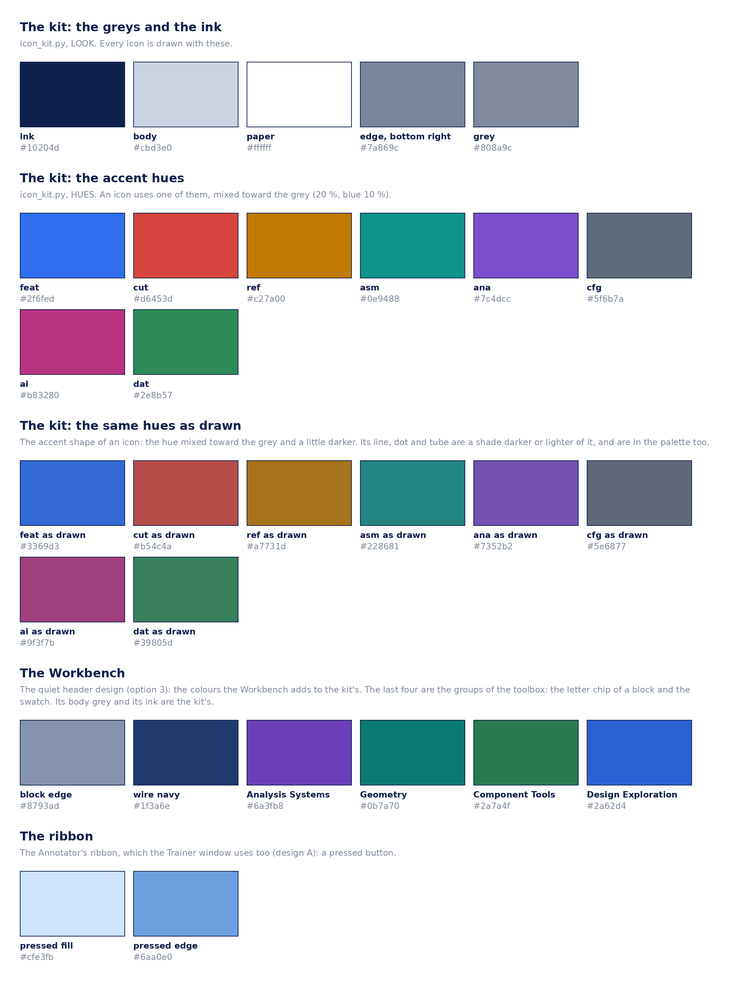

# Theme and palette

**Status:** written from the code on 2026-11-26. Ian approved the plan the same day: the palette is the icon kit's, a script checks new colours against it, and the colours already in the program are a baseline that can only shrink. He has not yet looked at the swatch sheet below.



## Where the palette is

| Part | Where | What |
|---|---|---|
| The kit: ink, body, paper, edge, grey | `icon_kit.py`, `LOOK` | The navy of the logo, a cool blue-grey body, white, and two greys. Every icon is drawn with them. |
| The kit: eight accent hues | `icon_kit.py`, `HUES` | `feat` blue, `cut` red, `ref` amber, `asm` teal, `ana` purple, `cfg` slate, `ai` magenta, `dat` green. An icon uses one, mixed toward the grey (20 %, blue 10 %). |
| The kit: the tones it draws | worked out from the two above | Four shades of each hue (accent shape, line, dot, tube). The checker works them out the way the kit does, and the test checks that it agrees. |
| The Workbench, the ribbon | [`palette.json`](palette.json) | The few colours the approved designs add: block edge, wire navy, the four toolbox groups, the pressed ribbon button. Each has what it is for and where it is used. |

`icon_kit.py` and `palette.json` are the palette. This page and the picture are a view of them, and the picture is drawn from them (`python tools/check_palette.py --swatches planning/design/theme/swatches.png`), so a change to either means drawing the picture again.

## The rules

1. **Use a colour that is already in the palette.** A new icon takes one of the eight hues and the kit's greys; a new screen takes the ink, the body grey, white and the hues.
2. **After making an icon, a stylesheet or a screen, run the checker on it** (below). It names every colour that is not in the palette and the nearest palette colour.
3. **A colour that is really needed and is not in the palette goes in `palette.json`**, with what it is for and where it is used, and the commit says why. Do not add a colour to make the checker pass.
4. **Write a new design's colours into its README** when they are not the kit's, so the board and the palette agree.

## The checker

```
python tools/check_palette.py path/to/file.py ...     check these files
python tools/check_palette.py --changed               the files that differ from origin/dev, and new ones
python tools/check_palette.py --all                   every program file
python tools/check_palette.py --list                  the palette
python tools/check_palette.py --tighten               lower the baseline after old colours were replaced
```

`python test_palette.py` runs the same check on the whole program and tests the checker itself.

**The baseline.** The program was written before the palette was. About 500 colours (1,230 uses in 105 files) are not in it. They are kept in `tools/palette_baseline.json`, per file with a count. A file may use an old colour fewer times than before and never more, and a file that is not in the baseline must be all palette. When old colours are replaced, `--tighten` writes the smaller baseline. It never adds.

**What it reads.** `#rrggbb`, and `#rgb` after a colon, a quote or a bracket, in the strings of a `.py` file (not its comments) and anywhere in a `.qss` or `.svg` file; `rgb(` and `rgba(`; `QColor(r, g, b)`. It does not read `#aarrggbb` or colour names, and it does not look at the colours of a picture file. It looks at the `.py` files of the program's root folder and at `shared/`, `dev_addons/`, `addons_src/` and `updater_tool/`; not at tests, `parked_addons/`, `docs/`, `installer/` or any `assets/` folder.

## What is not decided yet

The program's own screens use many near-duplicate colours that are not in the palette: five reds for an error (`#B00020`, `#C00000`, `#B3261E`, `#C0392B`, `#D62828`), several blues for a selection and a link, and pure greys for text. They are in the baseline. Picking one set of status colours (error, warning, done) and replacing the rest is GEN-5 in `../../ISSUES.md`. Until then a new screen should use the kit's hues for them (`cut` for an error, `ref` for a warning, `dat` for done) and the ink for text.
